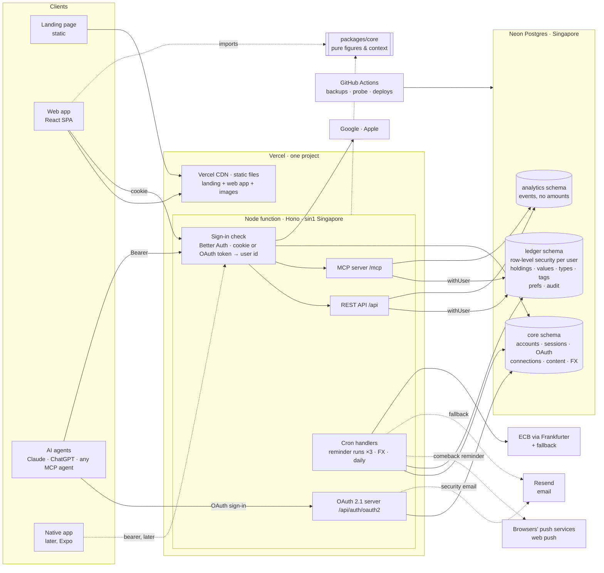
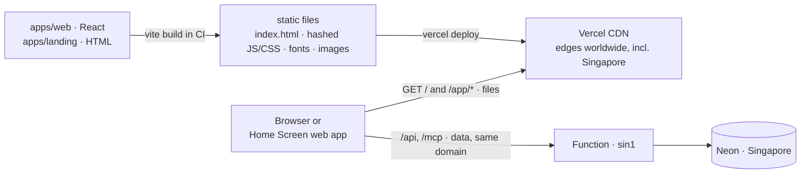

# 03 — Architecture

Status: **approved** · Stage owner: Staff software engineer
Inputs: `docs/01-prd.md`, `docs/02-prototype/prototype-notes.md`, `docs/02-prototype/design-system.md`

> Designs only what the first phases need (WORKFLOW Stage 3). §7 is the contract Stage 4 plans
> against and Stage 5 builds against. Where this document and the PRD disagree, the PRD wins and
> this document is wrong. Say so.

**Sources for Vercel and Neon.** Neon's figures are from Neon's own documentation source
(`github.com/neondatabase/website`, updated 2026-09-23). Vercel's site is blocked from this
environment, so Vercel's figures are from its docs as quoted in search results and from 2026
write-ups. The P1 spike re-checks them before anything depends on them.

---

## 1. The shape in one screen

- **One TypeScript codebase, one Vercel project.** The **web app** (React) and the **landing page**
  are built into static files and served from **Vercel's global CDN** on the Founder's domain (§5.2).
  One Node function (a Hono app, pinned to **Singapore**, `sin1`) answers the REST API, sign-in,
  the OAuth server agents connect through, and the MCP endpoint, on the same domain.
- **One Neon Postgres database in Singapore**, with three schemas: `ledger` (money), `core`
  (accounts, connections, packs, exchange rates) and `analytics` (events, never amounts).
- **Each user's money is walled off inside the database.** Every `ledger` table carries the user
  id, and **row-level security** makes Postgres itself return only the signed-in user's rows. The
  one way in is `withUser(userId, …)`, which sets the user for the transaction. A query that
  forgets its filter still cannot see another user (N4).
- **One set of pure functions computes every figure** (`packages/core`): net worth, what you could
  use, periods, carry-forward, the agent's context. The web app, the MCP tools and the native
  apps later all call the same code, so a figure never differs between screen and agent (N11).
- **The web app and the agent use the same write path.** A REST call and an MCP tool call reach
  the same Ledger function, with the same validation, audit entry and events. No capability is
  UI-only (J6), because there is only one implementation.
- **Packs and agent setup guides are versioned content, not code** (N10). They are validated
  documents in the database, published from `content/`, and editable later by an admin portal
  that writes the same rows.
- **NetNet sends two messages, both through one `notify()` function** (§7.10): the **comeback
  reminder** to someone who has not checked NetNet for 30 days (by web push on the devices where
  they turned it on, by email otherwise), and a **security email** when an agent is connected.
  Native push joins as a channel with the Expo apps.
- **Cost: $0 for the first ~70–100 users** (Vercel Hobby + Neon Free). Upgrades are plan changes,
  not code changes, and are triggered by measured limits (§9.4).

## 2. What drove it

| Requirement | What it forces |
|---|---|
| **N6** as close to $0 as possible for the first 100 users | Permanent free tiers only; every limit that can stop the service is monitored with an upgrade trigger |
| **N1** MCP ≥99.5% success, p95 <1.5 s | Function and database in the same region, so a request makes one long hop and many short ones. Cold starts are measured and have an upgrade trigger (§9.4) |
| **N4** isolation at the data layer, tested | Row-level security enforced by Postgres, a single `withUser` entry point, composite keys that make cross-user references impossible, and an isolation test suite |
| **N8** reliability never traded for cost | Free-tier stops (Neon's monthly compute cap) are watched and pre-empted, and our own daily backups cover Neon Free's 6-hour restore window |
| **N3 / J7** every write auditable and reversible; batches undo together | Postgres transactions around each write and its audit rows; a per-user row lock serialises one user's writes |
| **N10 / §2.3** packs are versioned data an admin will edit | A content store with versions, validation, audit and a published schema |
| **N11** context is deterministic | Figures come from pure functions with no clock, randomness or inference inside |
| **N7** native iOS/Android later (React Native + Expo) | One API; domain logic and chart geometry in plain TypeScript the native app imports |
| **§2.3 rule 2** IP country looked up on our own server or CDN | Vercel's own country header, never a browser-side third-party call |
| **J12** reminders only between 08:00 and 21:00 in each person's time zone, on Hobby's once-a-day cron | Three daily runs eight hours apart; each sends only to people for whom it is daytime right then (§9.3) |

## 3. Agent clients at launch

**Claude, plus the generic "Other agent" guide; ChatGPT once NetNet is listed in OpenAI's
directory** (PRD J5). ChatGPT's free plan allows no custom connector, so it could not be tested;
its guide stays in content, unlisted, until then. Grok and Muse are parked until after launch. The server is standard
remote MCP with OAuth and no client-specific code, so adding a named client later is content (a
guide, a logo), not a release.

| Client | How it identifies itself to our OAuth server | Source |
|---|---|---|
| **Claude** | CIMD ("Use Claude's published identity", recommended), DCR, or a pre-registered client. Confirmed in the P1 spike: CIMD `https://claude.ai/oauth/mcp-oauth-client-metadata`, protocol 2026-07-28, computer and phone | claude.com connector docs; Claude Help Center (2026-08-11); `docs/phases/P1/spike.md` |
| **ChatGPT** (unlisted until OpenAI's directory) | CIMD preferred, DCR, or a predefined client; PKCE. Untested: its free plan allows no custom connector. OpenAI's Codex connected in the P1 spike by CIMD (`https://chatgpt.com/oauth/codex/client.json`, protocol 2025-06-18) | 2026 guides; `docs/phases/P1/spike.md` |
| **Other agent** | Any client that supports remote MCP with OAuth: CIMD or DCR. One generic guide, no platform split, no screenshots | PRD J5 |

**Which client a connection is.** Analytics and the reminder's "Just ask Claude." need to know,
but an agent's registered name is free text chosen by the agent. So at approval the connection is
**classified** `claude`, `chatgpt` or `other` by matching a host (its CIMD client id URL's host,
or for DCR its redirect URI's host) against the `matchHosts` in the named guides (§7.8). Anything
unmatched is `other`. Events carry only that value, never the registered name (§7.7).

Which plans of each client allow a custom connector is **parked** (PRD §9).

**Protocol.** The current MCP specification is **2026-07-28**: stateless (no `initialize`, no
`Mcp-Session-Id`), CIMD preferred, DCR deprecated, RFC 9207 issuer checks required. Clients are
migrating at different speeds, so the server negotiates **2026-07-28, 2025-11-25 and 2025-06-18**,
and the OAuth server accepts **CIMD and DCR**. Stateless is also exactly what serverless functions
need: any request can land on any instance.

## 4. Stack

| Layer | Choice | Why |
|---|---|---|
| Language | **TypeScript** everywhere (strict), Node 22 LTS | One language for web, API, MCP and native (Expo): validation, domain logic and chart geometry are shared, not re-typed |
| Hosting | **Vercel Hobby** → Pro when a trigger fires (§9.4). One project: static files + one Node function (Fluid compute) in **`sin1` Singapore** | $0 to start; preview deployments per pull request; the function sits beside the database |
| Database | **Neon Postgres, Free** → Launch when a trigger fires. Region `aws-ap-southeast-1` (Singapore). Compute pinned to **0.25 CU** | $0 to start; Postgres is the conventional choice, and it is easy to move off; branches give each preview its own copy |
| Isolation | **Row-level security** + `withUser()` + composite keys | Enforced by the database, not by remembering a `WHERE` (§6.1) |
| DB access | **Drizzle ORM** over `pg` (node-postgres) through Neon's pooled connection; **drizzle-kit** migrations, RLS policies included | Typed SQL; interactive transactions; boring |
| HTTP | **Hono** | Small, typed, runs as a Vercel Node function unchanged; plain `Request`/`Response` |
| Validation | **zod** (`packages/contracts`) | One schema per contract: it validates REST bodies, defines MCP tool schemas, and types the web client |
| Accounts | **Better Auth** (library, tables in `core`): email + password, Google, Apple, email verification, reset | Its best-supported database is Postgres; its session model serves web now and Expo later. Neon's managed Better Auth was set aside: we need the OAuth provider plugin and our own approval page, which the managed service is not known to allow |
| Agent OAuth | **Better Auth's OAuth 2.1 provider plugin + CIMD package**; our MCP route checks tokens itself | CIMD, DCR, PKCE and audience-bound tokens with no hand-rolled security code; protocol-version support stays ours. **Fallback:** a standalone OAuth 2.1 library chosen in the P1 spike |
| MCP | **Official MCP TypeScript SDK** (v2), stateless Streamable HTTP, with Vercel's `mcp-handler` adapter if the spike shows it helps | The reference implementation; serves 2026-07-28 and falls back for 2025-era clients |
| Web app | **React + Vite SPA**, React Router, TanStack Query, CSS Modules on design tokens; installable (web app manifest) | All behind a login, so nothing to server-render. React pairs with the Expo decision |
| Web app hosting | **Vercel's CDN**, same project and domain as the API (§5.2) | Static files cost nothing to serve and load from an edge near the user; one domain means no CORS and a first-party cookie |
| Landing page | **Static HTML/CSS** (its own Vite entry) | A marketing page with its own design (PRD G-D1) |
| Charts | **No charting library.** `d3-scale` / `d3-shape` / `d3-array` maths, our own SVG | Three heavily specified chart kinds. Geometry lives in `core`, and native draws it through `react-native-svg` |
| Scheduled work | **Vercel Cron** (Hobby: each job at most daily, started within its hour) + **GitHub Actions** schedules | §9.3 |
| Email | **Resend**: the comeback reminder's fallback channel and the security email, through `notify()` (§7.10); also Better Auth's verification and reset emails | Permanent free tier (3,000/month, 100/day), shared by all four kinds of email (§9.4 trigger) |
| Web push | **v1, the comeback reminder's first channel.** The **Web Push** standard: VAPID keys, the `web-push` library in the function, a minimal service worker in the web app (§7.10) | Free and standard; delivered by the browsers' own push services; no vendor SDK in the web app |
| Native push | **Later, with the Expo apps:** Expo's push service (→ APNs, FCM), as another `notify()` channel | Free; no change to the server's shape |
| Errors | **Sentry** Developer plan (free), scrubbed (§10) | Function and browser errors in one place |
| Analytics | **First-party** events in the `analytics` schema | N9 enforced by the schema. No tracking SDK on pages that show money |
| FX rates | **ECB via Frankfurter** + a fallback source for currencies the ECB lacks (VND, TWD, AED…), fetched daily into our own table | Free, no key, history to 1999; a write never waits on a third party |
| Tests | **Vitest** against real **Postgres** (a service container in CI; PGlite where Docker is unavailable), **Playwright** E2E | `CONVENTIONS.md` §9 |
| CI/CD | **GitHub Actions** + Vercel CLI + drizzle-kit | §9.2 |

**Lock-in is low.** It is Node, Postgres and open protocols. Moving off Vercel or Neon means
changing a deploy target or a connection string, not the product.

## 5. Components



### 5.1 Three paths through it

**A web write** (e.g. add a value): SPA → `POST /api/holdings/:id/values` → the session cookie gives
`userId` → `withUser(userId, write)` opens a transaction, sets `app.user_id` and locks the user's
`ledger_state` row → `recordValues(tx, actor, items)` writes the value rows, the audit rows and the
new `data_version` → commit → respond → analytics events (`value_recorded {source: web}`) are
written after the response (`waitUntil`).

**An agent read** (J8): client → `POST /mcp` with a Bearer token → the function checks the JWT
itself against our JWKS (issuer, audience = the `/mcp` URL, expiry, scope) → `withUser(userId)`
checks the connection is not revoked and reads the user's data in-region → `core.compileContext()`
→ the tool result → after the response, `agent_tool_called {kind: read, latency_ms}` and
`touchChecked` (the person has checked NetNet today, J12; §7.10). **Warm: ≈ 0.25–0.3 s**, mostly
the trip from the client's servers to Singapore. **After 5 minutes idle, measured in the P1
spike: the first request on a new instance takes ≈ 0.9–1.4 s in the function** (the auth library
starting and Neon waking), ≈ 2.1–2.7 s as seen from the US; the calls after it are warm again.
Slow, not failed, and accepted for P1: `latency_ms` and the probe watch it, and §9.4 has the
trigger that removes it.

**Connecting an agent** (J5):

```mermaid
sequenceDiagram
  participant U as You (NetNet tab)
  participant C as Agent app (Claude / ChatGPT / other)
  participant S as NetNet server
  U->>S: POST /api/agent/attempts {client, entry}
  Note over U: shows the steps; polls the attempt every 2 s
  U->>C: adds connector URL https://‹domain›/mcp
  C->>S: POST /mcp (no token) → 401 + resource_metadata
  C->>S: GET /.well-known/oauth-protected-resource, /oauth-authorization-server
  C->>S: GET /api/auth/oauth2/authorize (PKCE, resource, client_id = CIMD URL or DCR id)
  S->>U: approval page — the name the client registered with — Allow / Cancel
  U->>S: Allow (email must be verified)
  S->>S: grant → agent_connection row (classified claude / chatgpt / other); the attempt becomes "approved"
  S-->>U: the NetNet tab moves on by itself
  Note over S: straight away, after the response: the security email to the account address (J5)
  C->>S: POST /api/auth/oauth2/token (code + verifier) → access + refresh token
  C->>S: first tool call → the attempt becomes "live"
```

### 5.2 Where the web app lives



| Question | Answer |
|---|---|
| Where are the files? | Built by Vite in CI (`apps/web` → `/app/*`, `apps/landing` → `/`) and deployed to **Vercel's CDN** in the same project as the function. Hobby includes 100 GB of transfer a month; the app is a few hundred KB, so that is tens of thousands of visits |
| What domain? | The Founder's domain for everything: `‹domain›/` (landing), `‹domain›/app` (web app), `‹domain›/api` and `‹domain›/mcp` (function). **One origin**: no CORS, the session cookie stays first-party, one TLS certificate (issued by Vercel) |
| How does routing work? | `vercel.json` rewrites send `/api/*` (the OAuth server included), `/mcp` and `/.well-known/*` to the function. `/app/*` falls back to the app's `index.html` (client-side routes). Everything else is a file |
| Caching | Hashed JS and CSS are cached forever (`immutable`). `index.html` is never cached, so a deploy reaches users on their next load. No financial data is ever cached at the edge: API responses carry `Cache-Control: private, no-store` |
| Previews | Every pull request gets its own full copy (files + function + Neon branch) at a preview URL |
| Installable, with push | A web app manifest (name, icons, `display: standalone`, `scope: /app/`) ships in v1, so the app can be added to a phone's Home Screen, which iOS requires before web push works. NetNet never explains that step: where a browser can't receive push, no push option is shown and reminders go by email (PRD J12). A **minimal service worker** (`/app/sw.js`) handles only `push` and `notificationclick`. It has **no fetch handler and caches nothing**, so financial data is never stored offline (§7.10) |
| Native apps (later) | Built with Expo and distributed through the App Store and Google Play. They call the same `/api` on the same domain; nothing about hosting changes |

## 6. Data model

One Postgres database. IDs are prefixed ULIDs (`usr_`, `hld_`, `val_`, `typ_`, `tag_`, `aud_`,
`bat_`, `con_`, `att_`). Money is stored as **integers in the currency's minor unit** (`bigint`,
ISO 4217 exponent). Value dates are `date`, and instants are `timestamptz`.

### 6.1 Schemas, roles and row-level security

| Role | Can | Cannot |
|---|---|---|
| `netnet_owner` | Own every table; run migrations (CI only) | Be used by the running app |
| `netnet_app` (the function) | Read/write `core`; read/write `ledger` **only through RLS**; insert into `analytics.event` | Bypass RLS (`NOBYPASSRLS`); read `analytics` |
| `netnet_metrics` (Founder's metrics queries) | Read `analytics` | Read `ledger` or `core` |
| `netnet_content_admin` (future portal) | Write `core.content_*` | Read `ledger`, `analytics`, identity |

**Every `ledger` table** has `user_id` in its primary key, `ENABLE` **and `FORCE ROW LEVEL
SECURITY`**, and one policy:
`USING (user_id = current_setting('app.user_id', true)) WITH CHECK (user_id = current_setting('app.user_id', true))`.
With no user set, a query sees nothing. **Foreign keys are composite** (`value (user_id,
holding_id) → holding (user_id, id)`), so no row can point at another user's row. A test fails
the build if any `ledger` table lacks RLS, `FORCE`, the policy, or composite keys.

**`withUser(userId, fn, {write})`** is the only way into the `ledger` schema. It opens a
transaction, calls `set_config('app.user_id', userId, true)` (transaction-local, which is safe with
Neon's transaction pooling), and for writes takes `SELECT … FROM ledger.ledger_state WHERE user_id =
$1 FOR UPDATE`. That lock serialises one user's writes, exactly as a single-threaded store would.
`userId` comes only from the verified session or token.

### 6.2 `core` — no money in it

| Table | Key columns | Notes |
|---|---|---|
| `user`, `session`, `account`, `verification`, `jwks` | Better Auth's schema | Email, password hash (scrypt), provider links, `email_verified` |
| `profile` | `user_id` PK, `country` (ISO 3166-1, nullable), `time_zone` (IANA, never null: the browser's at sign-up, `UTC` if it gives none), `segment` (`starting_out`/`accumulating`/`established`/`unknown`), `onboarding_state`, `created_at` | What every request needs: the pack to resolve, the segment every event carries (§3.5), where to resume onboarding (J1). `time_zone` also decides "today" and the reminder's daytime (J12); the web app updates it when the browser reports another |
| `oauth_client`, `oauth_access_token`, `oauth_refresh_token`, `oauth_consent` | The OAuth plugin's schema | CIMD clients cached by URL; DCR clients unused for 30 days are purged |
| `agent_connection` | `id` (`con_`), `user_id`, `client_id`, `client_name`, `registration` (`cimd`/`dcr`), **`client`** (`claude`/`chatgpt`/`other`, §3), `created_at`, `first_call_at`, `last_used_at`, `revoked_at`, **`security_email_sent_at`** | The Agent tab (J5). Checked inside `withUser` on every agent call, so revocation applies to the next call. `security_email_sent_at` stays null until Resend accepts the security email, so a failed send is retried (§7.10) |
| `connection_attempt` | `id`, `user_id`, `client` (`claude`/`chatgpt`/`other`: the guide chosen), `entry` (`onboarding`/`home`/`holding`/`agent`), `platform`, `state` (`started`/`approved`/`live`/`failed`), `failed_step`, `started_at`, `updated_at` | "Moves on by itself" and `agent_connection_* {entry}`. Timeouts are worked out when an attempt is read (no frequent cron on Hobby) |
| `content_doc` | (`kind`, `key`, `version`) PK, `body` jsonb, `sha256`, `author`, `source_commit`, `created_at` | Packs, the country list, agent guides. **Immutable once written** |
| `content_current` | (`kind`, `key`) PK, `version`, `updated_at`, `updated_by` | Which version is live. Rolling back = pointing at an older version |
| `content_audit` | `id`, `kind`, `key`, `from_version`, `to_version`, `actor`, `at` | Who changed the world, when, old → new (§2.3) |
| `fx_rate` | (`date`, `currency`) PK, `per_usd` numeric, `source` (`ecb`/`fallback`) | Filled daily; history backfilled once |
| `rate_limit` | (`key`, `window_start`) PK, `count` | Fixed-window counters (§8) |
| `notification_endpoint` | `id`, `user_id`, `channel` (`webpush`; `expo` later), `endpoint` (push service URL), `keys` jsonb (`p256dh`, `auth`), `platform` (`ios`/`android`/`desktop`), `device_label` (e.g. "Android · Chrome"), `created_at`, `last_seen_at`, `last_success_at`, `failure_count`, `revoked_at` | One row per device where push is on (J12). **Active** = not revoked. Revoked when the person turns the device off or removes it, on sign-out on that device, and when the push service answers `404`/`410` or fails five times in a row. Deleted with the account. `last_seen_at` is "last used" in the device list |
| `reminder_state` | `user_id` PK, `enabled` (the Reminders switch, default on), `email_enabled` (default on), `last_checked_on` date, `next_due_on` date, `sent_since_check` smallint, `last_sent_at`, `last_channel` (`push`/`email`), `last_opened_at` | The comeback reminder (J12). Dates are in the person's `time_zone`. Created at sign-up with `last_checked_on` = that day, `next_due_on` = +30. In `core`, not `ledger`, because the reminder job reads it across users and it holds no money |

### 6.3 `ledger` — every row belongs to one user

| Table | Columns (all have `user_id`) | Notes |
|---|---|---|
| `ledger_state` | `user_id` PK, `base_currency`, `data_version`, `created_at` | `data_version` goes up by one on every write, and is the snapshot's ETag. The row is the per-user write lock. (Reminder timing lives in `core.reminder_state`) |
| `user_type` | `id`, `universal` (§7.8), `pack_type_key` (nullable, e.g. `car_loan`), `custom_name` (nullable), `sort`, `archived` | **No name is stored until the user renames one**, so labels follow the current pack |
| `tag` | `id`, `name` (unique per user, case-insensitive), `sort` | |
| `holding` | `id`, `name`, `kind` (`asset`/`liability`), `type_id`, `currency`, `cadence_days`, `archived_at`, `created_at`, `row_version`, **`access`** (`accessible`/`illiquid`/`locked`/`undecided`, null for liabilities), **`access_basis`** jsonb `{via, pack, pack_version, question, answer}`, **`access_reason`**, **`access_until`** | The applied accessibility outcome **and its reason** are kept as applied, with the pack version. A pack edit never moves them (§6.7) |
| `holding_tag` | `holding_id`, `tag_id` | |
| `value` | `id`, `holding_id`, `date`, `amount_minor`, `currency`, `base_minor`, `base_currency`, `fx_rate` numeric, `fx_rate_date`, `fx_source` (`ecb`/`fallback`/`same`/`user`/`agent`), `source` (`web`/`agent`/`system`), `client_name`, `connection_id`, `batch_id`, `entered_at`, `updated_at`, `row_version` | **Unique (`user_id`, `holding_id`, `date`)**: last write wins, with a warning (J3). `base_minor` is the stored conversion that totals and periods use (J2, J11) |
| `prefs` | `key`, `value` jsonb | Home filter, Insights filter and exclusions (persist, J11), baseline, sort |
| `audit` | `id`, `at`, `actor` (`user`/`agent`/`system`), `client_name`, `connection_id`, `batch_id`, `action`, `entity`, `entity_id`, `before` jsonb, `after` jsonb, `undoes`, `undone_by` | One row per entity changed. `before` for a deleted holding includes its values |
| `batch` | `id`, `connection_id`, `opened_at`, `last_write_at` | One agent turn (§6.8) |

### 6.4 `analytics`

`event(id, name, at, user_id NULL, visitor NULL, segment, props jsonb, app_version)`. It is written
only through the typed `track()` (§7.7), so no amount, name or document text can reach it.
`visitor` is `sha256(daily_salt ‖ ip ‖ user-agent)`, truncated. The salt changes daily and is never
stored, so the landing page counts unique visitors (M10) without a cookie. When an account is
deleted, its events are **re-keyed to a random id**: they still count, and they no longer point at
anyone.

### 6.5 Content (packs, countries, agent guides)

- **Source:** `content/packs/*.json`, `content/countries.json`, `content/agents/*.json` (launch:
  `claude.json`, `chatgpt.json`, `other.json`; Grok and Muse are added after launch, as content);
  screenshots and logos in `content/images/`.
- **Publishing:** `pnpm content:publish --env <env>` validates every document against its schema
  (§7.8). Any failure rejects the whole publish, because a half-applied pack is a wrong pack. It then
  inserts new `content_doc` versions, moves `content_current` and writes `content_audit`. **No code
  release.** Images ship as static files through a content-only deploy.
- **Reading:** the function caches `content_current` for 60 s and each version indefinitely. The
  web app fetches `GET /api/content/:kind/:key@:version`, cached for a year.
- **The admin portal (not v1)** writes the same tables through the same validator, as
  `netnet_content_admin`, which has **no access to `ledger`, `analytics` or identity**. Nothing in
  v1 has to change for it.

### 6.6 Money and exchange rates

- **Minor units everywhere below the edges.** Tools and forms take and return decimal amounts in
  major units. The boundary converts using the ISO 4217 exponent and rejects extra precision and
  anything over 10¹⁵ minor units with a specific error (J6).
- **Rate:** the published rate for the value's date (latest on or before it), **looked up once when
  the value is written, stored on the value, never refreshed** (PRD J2, J11; §4.2 reserves refresh).
  Cross rates go through USD. Before the fallback source's history begins, the nearest later rate is
  used and its date recorded. The web and the agent may supply a rate (`fx_source: user|agent`),
  e.g. the one on a statement.
- **Conversion** is exact decimal arithmetic, rounded half away from zero. Rate and rate date are
  stored, exported and readable by the agent, and not displayed (J2).
- **Changing the default currency** re-derives every value's `base_minor` from the stored rates at
  each value's own `fx_rate_date`. That is one logged, undoable `system` change (J11 stays
  undistorted).
- If the day's fetch fails, the previous rate stays in use with its date, and an alert fires.

### 6.7 Accessibility and pack versions (PRD §2.3)

`core.resolveAccess(packChain, universal, answer?)` returns `{access, reason, until, basis}`.
**Current pack, then generic, key by key**, as in the prototype. At create or change time the whole
outcome is written onto the holding with the pack key and version. Afterwards **labels follow the
current pack; outcomes and their reasons do not.** A later re-application is an explicit, logged
`system` migration, with an audit entry per holding (none in v1). **Undecided** counts toward net
worth, never toward what could be used, and is reported to the agent as incompleteness (J2).
**Moving country** adds the new pack's default types and removes none (J2).

### 6.8 Audit, batches and undo (N3, J7)

- **Every write** is one transaction: the change, one audit row per entity touched, `data_version +
  1`. Nothing is ever partially written (J6).
- **Batches (one agent turn).** MCP has no turn id, and the 2026-07-28 spec removed sessions. A
  connection's writes join one batch while each follows the previous by **≤ 120 s**. A single
  `record_values` call is always one batch. The per-user lock makes the grouping exact. It is a
  heuristic, tuned by M5 evidence.
- **Undo of an entry** restores `before` exactly, and only if the entity is still at the entry's
  `after` (by `row_version`). Otherwise the result is `UNDO_CONFLICT`, naming the later change to
  undo first. The undo is itself an audit entry, so it can be undone too.
- **Undo of a batch** reverts every not-yet-undone entry, newest first, in one transaction. It is
  all or nothing.
- A user correcting or undoing an agent-written value fires `value_corrected {original_source:
  agent, age_at_correction}` or `value_undone` (M5).

## 7. Interface contracts

### 7.1 URL map (one origin: `https://‹domain›`)

| Path | What | Served by |
|---|---|---|
| `/` | Landing page | static |
| `/app/*` | Web app (SPA fallback). Approval page: `/app/connect/approve` | static |
| `/content/*` | Screenshots and logos | static |
| `/api/*` | REST API, JSON; cookie session (web), bearer session (native later) | function |
| `/api/auth/*` | Better Auth: sign-up, sign-in (email, Google, Apple), verify email, reset, sign-out | function |
| `/api/cron/*` | Cron handlers; require `Authorization: Bearer $CRON_SECRET` | function |
| `/api/auth/oauth2/authorize` · `/api/auth/oauth2/token` · `/api/auth/oauth2/register` (DCR) · `/api/auth/oauth2/revoke` · `/api/auth/jwks` | OAuth 2.1 authorization server, at the library's own paths; clients find them in the metadata | function |
| `/.well-known/oauth-authorization-server` · `/.well-known/oauth-protected-resource` (and `/…/mcp`) | RFC 8414 and RFC 9728 metadata; `client_id_metadata_document_supported: true` | function |
| `/mcp` | **The connector URL users paste.** MCP Streamable HTTP, `POST`, stateless | function |

### 7.2 REST API (web now, native later)

Errors are always `{"error": {"code", "message", "fields"?: {path: message}}}` (§7.5 codes).
Writes return `{result, dataVersion, warnings: [{code, message}]}`.

| Method & path | Body / query → response | Jobs |
|---|---|---|
| `GET /api/geo` | → `{country: "SG" \| null}` from `x-vercel-ip-country` | §2.3 r2 |
| `GET /api/me` · `PATCH /api/me` | profile: `email, emailVerified, country, baseCurrency, segment, timeZone, onboardingState` | J1 |
| `GET /api/snapshot` | `If-None-Match: <dataVersion>` → 304, or `{dataVersion, baseCurrency, packRef, prefs, types, tags, holdings, values}`. Values compact per holding: `[date, amountMinor, currency, baseMinor, source, clientName, id]` | J4, J11 |
| `POST /api/holdings` | `{name, kind, typeId, currency, tagIds?, access?: AccessInput, opening?: {amount, date, fxRate?}, via: "guided"\|"form", allowDuplicate?}` → `Holding`, or `409 LIKELY_DUPLICATE {candidates}` | J1, J2, J6 |
| `PATCH /api/holdings/:id` | `{name?, typeId?, tagIds?, access?, cadenceDays?, archived?}` | J2 |
| `DELETE /api/holdings/:id` | — | J2 |
| `GET /api/holdings/:id/values` | `?cursor&limit≤200` → `{items, nextCursor}`, newest first | J4 |
| `POST /api/holdings/:id/values` | `{amount, date, currency?, fxRate?}` → warning `SAME_DATE_REPLACED` when it replaces | J3 |
| `PATCH /api/values/:id` · `DELETE /api/values/:id` | `{amount?, date?, currency?, fxRate?}` | J3 |
| `POST /api/types` · `PATCH /api/types/:id` · `DELETE /api/types/:id?moveTo=` | create / rename / delete or merge; holdings follow, nothing orphaned | J2 |
| `POST /api/tags` · `PATCH /api/tags/:id` · `DELETE /api/tags/:id?mergeInto=` | same for tags | J2 |
| `GET /api/activity` | `?cursor&limit≤100` → audit entries, newest first, grouped by batch | J7 |
| `POST /api/activity/:entryId/undo` · `POST /api/activity/batches/:batchId/undo` | → `UNDO_CONFLICT {blockers}` when not possible | J7 |
| `PATCH /api/prefs` | filters, exclusions, baseline, sort | J4, J11 |
| `GET /api/notifications/prefs` | → `{reminders: bool, email: bool, emailVerified: bool, devices: [{id, label, platform, lastSeenAt}]}` (active devices only) | J12 |
| `PATCH /api/notifications/prefs` | `{reminders?: bool, email?: bool}`; applies at once | J12 |
| `GET /api/notifications/vapid-key` | → `{publicKey}` | J12 |
| `POST /api/notifications/endpoints` | `{endpoint, keys: {p256dh, auth}, platform, deviceLabel}` → `{id}`; idempotent per endpoint URL (re-activates a revoked row). Fires `push_enabled` | J12 |
| `PUT /api/notifications/endpoints/:id` | `{endpoint, keys}`, sent by the web app when a session starts on a device with push on → `204` (updates `last_seen_at`, and the subscription if the browser rotated it), or `404` when the device was removed, and then the web app unsubscribes locally and shows the switch off | J12 |
| `DELETE /api/notifications/endpoints/:id` | `?by=user\|signout`: the switch turned off or Remove (`user`), or signing out on this device (`signout`). Fires `push_disabled {by}` | J12 |
| `POST /api/reminders/opened` | `{token}`, no session needed. Sent by the web app when it opens from a reminder (`/app/?r=<token>`). Fires `reminder_opened {channel}` for the first open of that reminder only → `204` | J12 |
| `GET /api/agent/connections` · `DELETE /api/agent/connections/:id` | list · revoke (logged; later calls rejected) | J5 |
| `POST /api/agent/attempts` · `GET /api/agent/attempts/:id` | `{client: "claude"\|"chatgpt"\|"other", entry, platform}` → `{id, state, failedStep?, cause?}` (polled every 2 s) | J5 |
| `GET /api/content/current` · `GET /api/content/:kind/:key@:version` | live version map · an immutable document | §2.3, J5 |
| `GET /api/export?format=json\|csv` | everything: holdings, types, tags, accessibility and the answer behind it, all values with currencies, rates and rate dates | J10 |
| `DELETE /api/account` | needs a sign-in in the last 10 minutes → `{erasedWithinDays: 30}` | J10 |
| `POST /api/events` | client-side events only (§7.7): `{name, props}`, whitelisted | §3.5 |
| `POST /api/reminders/unsubscribe` | signed token; turns email reminders off. The target of `List-Unsubscribe-Post` (RFC 8058), and of the email footer's link through a page that posts once it loads, so a mail scanner fetching the link changes nothing | J12 |
| `GET /api/health` | **Shallow: never touches the database** → `{ok}` | §10 |

**Pagination:** values, activity and the MCP lists page with an opaque cursor. The
web app's `snapshot` is **not paged in v1**. A heavy P-C (30 holdings × monthly × 5 years ≈ 1,800
values) is about 30 KB gzipped, and loading it once makes filters, baselines and Insights instant
with the same `core` code. **Revisit trigger:** 1 MB gzipped or 20,000 values, logged per request.

### 7.3 The Ledger module (the only code that touches the `ledger` schema)

```ts
type Actor = { kind: 'user' | 'agent' | 'system'; connectionId?: string; clientName?: string };
type Write<T> = { result: T; dataVersion: number; warnings: Warning[]; events: DomainEvent[] };

// The only entry point. Opens a transaction, sets app.user_id, checks the agent connection when
// the actor is an agent, and for writes locks ledger_state for this user.
function withUser<T>(userId: string, actor: Actor, fn: (l: Ledger) => Promise<T>,
                     opts?: { write?: boolean }): Promise<T>;

interface Ledger {
  init(i: { baseCurrency: string; pack: PackRef }): Promise<void>;
  snapshot(): Promise<Snapshot>;
  context(o: { baseline?: Baseline; today: string; packs: Pack[] }): Promise<FinancialContext>; // §7.5
  listHoldings(q: HoldingQuery): Promise<Page<HoldingView>>;
  getHolding(id: string, values?: PageReq): Promise<HoldingDetail>;
  history(q: HistoryQuery): Promise<Series>;
  periods(q: PeriodQuery): Promise<PeriodTable>;
  activity(p: PageReq & { batchId?: string }): Promise<Page<AuditEntry>>;

  createHolding(i: CreateHolding): Promise<Write<Holding>>;
  updateHolding(id: string, p: HoldingPatch): Promise<Write<Holding>>;
  deleteHolding(id: string): Promise<Write<void>>;
  recordValues(items: NewValue[]): Promise<Write<ValueResult[]>>;   // 1..200, atomic
  updateValue(id: string, p: ValuePatch): Promise<Write<Value>>;
  deleteValue(id: string): Promise<Write<void>>;
  upsertType(i: TypeInput): Promise<Write<UserType>>;
  deleteType(id: string, moveTo?: string): Promise<Write<void>>;
  upsertTag(i: TagInput): Promise<Write<Tag>>;
  deleteTag(id: string, mergeInto?: string): Promise<Write<void>>;
  undo(t: { entryId: string } | { batchId: string }): Promise<Write<UndoResult>>;
  setPrefs(p: PrefsPatch): Promise<Write<Prefs>>;
  changeBaseCurrency(ccy: string): Promise<Write<void>>;
  applyPackTypes(pack: PackRef): Promise<Write<UserType[]>>;
  exportAll(): Promise<ExportBundle>;
  destroy(): Promise<void>;                       // deletes every ledger row for this user
}
```

Lint forbids importing the `ledger` schema outside `apps/api/src/ledger/**` (`CONVENTIONS.md` §3).
The isolation suite (§8) attacks `withUser` and the RLS policies directly.

### 7.4 MCP server

**Transport and protocol.** Streamable HTTP at `/mcp`, stateless. Every request is authenticated
and served on its own, on any function instance. Protocol versions **2026-07-28, 2025-11-25,
2025-06-18**. Tools declare `inputSchema`, `outputSchema` and annotations (`readOnlyHint`,
`destructiveHint`, `idempotentHint`, `openWorldHint: false`), and return `structuredContent` plus
a short text rendering. Names and parameters are `snake_case`. Amounts are decimals in major units
with their currency. Every list is paged. **Server instructions** (a few lines): call
`get_financial_context` first for any question about the user's position; NetNet states facts and
uncertainty, and advice is yours; look for an existing holding before creating one; for a setup
conversation, ask what `get_setup_guide` asks.

**Scopes.** `ledger.read`, `ledger.write`. v1's approval page grants both (PRD §4.2). Keeping them
separate allows a read-only connection later.

| Tool | Kind | Input (main fields) | Returns | Jobs |
|---|---|---|---|---|
| `get_financial_context` | read | `baseline?` (`last_update`/`last_month`/`last_quarter`/`year_start`/`last_year`/`initial`) | §7.5, one call enough to answer | **J8** |
| `list_holdings` | read | `query?, type_ids?, tag_ids?, archived? (exclude\|include\|only), stale_only?, cursor?, limit≤100` | holdings with latest value, as-of, staleness, access | J6, J8 |
| `get_holding` | read | `holding_id, values_cursor?, values_limit≤500` | holding + paged values with provenance | J6, J8 |
| `get_net_worth_history` | read | `from?, to?, interval (month\|quarter\|year\|day), group_by? (none\|type\|access\|currency), type_ids?, tag_ids?` | series; each point carried or observed | J8, J11 |
| `get_period_changes` | read | `view (monthly\|quarterly\|yearly), periods?≤24, drivers?` | period-end value, change, %, top contributors | J11 |
| `get_taxonomy` | read | — | types (label, universal meaning) and tags | J6 |
| `get_setup_guide` | read | `country?` | this country's basics and the fact questions per type | J6 |
| `list_activity` | read | `cursor?, limit≤100, batch_id?` | audit entries | J7 |
| `create_holding` | write | `name, kind, type_id \| universal_type, currency, tag_ids?, access_answer? (answer id \| "not_sure"), opening_value? {amount, date?, fx_rate?}, allow_duplicate?` | holding, or `LIKELY_DUPLICATE {candidates}` | J6 |
| `update_holding` | write | `holding_id, name?, type_id?, tag_ids?, access_answer?, cadence_days?, archived?` | holding | J6 |
| `delete_holding` | write · destructive | `holding_id` | — | J6 |
| `record_values` | write | `values: [{holding_id, amount, date?, currency?, fx_rate?}] (1..200)` | per item: value id, replaced?, warnings | **J6** |
| `update_value` | write | `value_id, amount?, date?, currency?, fx_rate?` | value | J6 |
| `delete_value` | write · destructive | `value_id` | — | J6 |
| `upsert_type` | write | `type_id?, name, universal_type?` | type | J6 |
| `delete_type` | write · destructive | `type_id, move_holdings_to?` | — (merge = delete with move) | J6 |
| `upsert_tag` | write | `tag_id?, name` | tag | J6 |
| `delete_tag` | write · destructive | `tag_id, merge_into?` | — | J6 |
| `undo` | write | `entry_id \| batch_id` | what was restored, or `UNDO_CONFLICT` | J7 |

**Deliberately not agent tools:** account deletion, export, revoking connections, changing email
or password.

**Duplicates** (J6): `create_holding` compares against existing holdings (normalised name
similarity, same kind, same currency, compatible type). Unless `allow_duplicate: true`, it
returns `LIKELY_DUPLICATE` with up to three candidates. Deterministic, no inference (N11).

### 7.5 `get_financial_context`, and the error codes

Deterministic output of `core.compileContext(ledgerData, packChain, today, options)`. **At most
8 KB** of JSON for any user. Sections are ordered by importance, and holdings largest first,
capped at 25. The rest is summarised by type, with a pointer to `list_holdings`. What a type of
holding is (its pack `meaning`) is given once per type in `types`, not on every holding.

```jsonc
{
  "as_of": "2026-09-27", "currency": "SGD",
  "answer_guide": [
    { "for": "affordability — can I pay for X from what I have", "use": "totals.could_use",
      "never": "totals.net_worth", "note": "undecided and locked money is excluded" },
    { "for": "progress — am I on track, how did I do", "use": "totals.net_worth, change" },
    { "for": "exposure and risk", "use": "exposure" },
    { "for": "debt burden", "use": "totals.owed, owed_to_could_use" }
  ],
  "totals": {
    "net_worth": 1840250.00, "assets": 2310250.00, "owed": 470000.00,
    "could_use": 1040000.00, "sell_first": 120000.00, "locked": 1150250.00, "undecided": 0,
    "owed_to_could_use": 0.45,
    "change": { "baseline": "last_month", "since": "2026-08-31", "amount": 12400.00, "pct": 0.68 }
  },
  "picture": {
    "holdings": 12, "stale": 1, "undecided": 0, "without_value": 0,
    "oldest_value_days": 410, "freshness": "some_stale",
    "notes": ["Car value is 410 days old", "NetNet only knows what has been added"]
  },
  "exposure": {
    "by_currency": [{ "currency": "SGD", "share": 0.77 }, { "currency": "USD", "share": 0.23 }],
    "concentration": [{ "holding_id": "hld_…", "name": "HDB flat", "share": 0.41 }]
  },
  "types": [
    { "type": "CPF",
      "meaning": "Mandatory retirement account. Counts toward net worth, never toward what can be spent this month." }
  ],
  "holdings": [
    { "id": "hld_…", "name": "CPF Ordinary Account", "type": "CPF",
      "access": "locked", "access_reason": "CPF is locked until you’re eligible to withdraw",
      "until": "until you’re eligible to withdraw",
      "value": { "amount": 117100.00, "currency": "SGD", "base": 117100.00, "as_of": "2026-08-04",
                 "age_days": 54, "stale": false, "written_by": "agent:Claude" },
      "change": { "amount": 1400.00, "pct": 1.21 } }
  ],
  "omitted": { "holdings": 0, "hint": "list_holdings returns every holding" }
}
```

It states facts and uncertainty and never what to do (§8, N2). A golden-file test pins the output
byte for byte for fixed inputs (N11).

| Code | HTTP | Meaning |
|---|---|---|
| `VALIDATION_FAILED` | 400 | `fields` names each bad field and the allowed form |
| `OUT_OF_RANGE` | 400 | e.g. more decimals than the currency allows, a date far in the future |
| `CURRENCY_UNSUPPORTED` | 400 | not an ISO 4217 code we have rates for; lists the nearest matches |
| `UNAUTHENTICATED` | 401 | no valid session on a route that needs one; the web app sends the person to sign in. An agent without a valid token gets OAuth's `401` instead (§7.6) |
| `NOT_FOUND` | 404 | also for another user's ids. Never "forbidden", which would confirm the id exists |
| `LIKELY_DUPLICATE` | 409 | `candidates: [{id, name, latest}]`; retry with `allow_duplicate` |
| `UNDO_CONFLICT` | 409 | `blockers: [{entry_id, action, at}]` |
| `EMAIL_NOT_VERIFIED` | 403 | connecting an agent before verifying (J1, J5) |
| `SCOPE_REQUIRED` | 403 | token lacks `ledger.write` |
| `REAUTH_REQUIRED` | 401 | account deletion needs a recent sign-in |
| `RATE_LIMITED` | 429 | with `retry_after_s` |
| `INTERNAL` | 500 | with a request id; details go to Sentry, never to the caller |

### 7.6 OAuth for agents

- The **resource** is `https://‹domain›/mcp`. An unauthenticated call gets `401` with
  `WWW-Authenticate: Bearer resource_metadata="…/.well-known/oauth-protected-resource"`.
- **Client registration:** CIMD (the `client_id` is an HTTPS URL; metadata fetched over public
  HTTPS only, at most 5 KB, cached for up to 24 h) **and** DCR (RFC 7591), rate-limited per IP.
  Both stay on because the "Other agent" guide promises that any standard MCP agent can connect.
- **Authorization code + PKCE S256 only.** Exact redirect URI match. RFC 8707 `resource` required.
  RFC 9207 `iss` in the response.
- **Approval page** `/app/connect/approve`: needs a signed-in, **email-verified** user. Shows the
  name the client registered with (for a DCR client, that NetNet cannot verify it). **Allow** /
  **Cancel**. `frame-ancestors 'none'`. It is shown for **every** new connection: a remembered
  approval is never used, so each connection is a deliberate Allow and sends the security email.
- **Browser redirects:** the library answers a browser's authorize request with a JSON
  `{redirect, url}`; the function turns every such `GET` into a `302`, keeping its cookies (the
  P1 spike's first real run stopped on that JSON).
- **Tokens:** access tokens are JWTs (our JWKS, 1 h, `aud` = the resource, `sub`, `client_id`,
  `scope`), checked in the function with no database lookup. Refresh tokens rotate and last 90 days
  sliding.
- **Revocation** (J5): `DELETE /api/agent/connections/:id` sets `revoked_at` and revokes the
  refresh tokens. `withUser` checks `revoked_at` on every agent call, so the next call is rejected
  whatever the remaining life of its access token. An audit entry records it.
- **Security email** (J5): every **Allow** sends one, straight away, by email only (§7.10).

### 7.7 Analytics events (§3.5)

One typed function, `track(name, props, ctx)`, with a strict zod schema per name. Unknown props
are rejected, and the only strings allowed are enums. `client` is always `claude`, `chatgpt` or
`other`: the guide chosen (client side) or the connection's classification (server side, §3),
never the name an agent registered with. `segment`, `user_id` and `app_version` are attached by
`track()` itself. **Client-side** events come through `POST /api/events`, and only the names
marked *client* are accepted.

| Event | Props | Emitted by |
|---|---|---|
| `landing_view` | — (plus `visitor` hash) | client (landing) |
| `signup_started` | `method` | client |
| `account_created` | `method` | server (auth hook) |
| `session_started` | — | client (new session after 30 min idle) |
| `holding_created` | `source`, `via?` (`guided`/`form`, web only) | server |
| `value_recorded` | `source` | server |
| `value_corrected` | `original_source`, `age_at_correction` (days) | server |
| `value_undone` | — | server |
| `agent_connection_started` | `client`, `entry` | client (connect flow) |
| `agent_connection_completed` | `client`, `entry` | server (approval) |
| `agent_connection_failed` | `step`, `client`, `entry` | server. `authorise`: Cancel or an invalid request. `callback`: token exchange failed. `discovery`: no authorize request within 15 min of starting. `first_call`: no successful call within 15 min of the token. The two timeouts are recorded when the attempt is next read, or by the daily sweep |
| `agent_tool_called` | `tool`, `kind`, `outcome` (`ok`/error code), `latency_ms`, `client` | server (MCP) |
| `insights_viewed` | `view` | client |
| `reminder_sent` | `channel` (`push`/`email`) | server (reminder run). **One per reminder**, however many devices it reached; `email` when it fell back |
| `reminder_opened` | `channel` | server (`POST /api/reminders/opened`), the first open of each reminder only. **Opened means tapped or clicked**: no email-open pixel, which would be a tracker and is meaningless under Apple Mail's image prefetching |
| `security_email_sent` | `client` | server, when Resend accepts the security email (J5) |
| `push_prompt_shown` | `entry` (`home`/`settings`) | client: the Home card seen, or Settings → Notifications opened with this device undecided |
| `push_prompt_result` | `entry`, `result` (`granted`/`denied`/`not_now`) | client |
| `push_enabled` | `platform` | server (endpoint saved) |
| `push_disabled` | `platform`, `by` (`user`/`browser`/`signout`) | server. `user`: switched off or removed; `browser`: `404`/`410` or five failures in a row; `signout`: signed out on that device. **None on account deletion** (J12) |
| `account_deleted` | — | server |

`ops/metrics/*.sql`, run as `netnet_metrics`, computes M1–M11 and M13 per segment from this table
alone, so no metric can read a balance. M13's "checked NetNet within 7 days" is a `session_started`
or an `agent_tool_called` by the same user after `reminder_sent`. M12 is a separate benchmark
harness (§12, risk 9).

### 7.8 Content schemas

```ts
type Universal = 'cash'|'listed'|'retirement'|'property'|'vehicle'|'equity'|'crypto'
               |'mortgage'|'loan'|'wrapper'|'card'|'other';
type Access = 'accessible'|'illiquid'|'locked';
type Outcome = { access: Access; reason: string; until?: string };

type Pack = {                                    // kind 'pack', key 'generic' | 'sg' | …
  id: string; locale: string | null; currency: string | null;
  labels: Partial<Record<Universal, string>>;    // generic: all required
  examples: Partial<Record<Universal, string>>;
  meaning: Partial<Record<Universal, string>>;   // what the agent is told a type is (§2.4)
  cadenceDays: Partial<Record<Universal, number>>; // expected update cadence (J9)
  defaults: Partial<Record<Universal, Outcome>>;
  questions: Partial<Record<Universal, { ask: string; answers: ({ id: string; label: string } & Outcome)[] }>>;
  types: { key: string; u: Universal; label: string; example?: string }[];
  checklist: { id: string; u: Universal; type?: string; name: string; ask: string; amount: string;
               answer?: string; onlyIf?: string; hint?: string }[];
};
type Countries = Record<string /* ISO 3166-1 alpha-2, plus XK */, { currency: string; pack?: string }>;
type AgentGuide = {                              // kind 'agent', key 'claude' | 'chatgpt' | 'other' at launch
  id: string; name: string; logo?: string; listed: boolean; order: number;
  plans?: string;
  prefillUrl?: string;                           // e.g. https://claude.ai/new?q={prompt}
  matchHosts?: string[];                         // hosts that classify a connection as this client (§3)
  platforms: Partial<Record<'phone'|'computer'|'any', { steps: { text: string; image?: string; prompt?: string }[] }>>;
};
```

Validation (enforced by `content:publish`): generic defines every `labels`, `meaning`,
`cadenceDays` and the `other` question. Every `onlyIf` names an earlier checklist item. Every
`type` names a pack type. Answer ids are unique within a question. Every country's currency is
ISO 4217. Pack ids are unique. The `other` guide has only `any` steps, no images, no logo and no
`matchHosts`; every other listed guide has a logo and `matchHosts`, and no host is claimed twice. Starting content is the prototype's `packs.js` (generic, SG, MY,
GB). The other seven launch packs are content work, each reviewed by someone who knows the market.

### 7.9 `packages/core` (pure; the functions everything else calls)

```ts
toMinor(amount: string | number, ccy: string): number | Err;  // safe integer; |x| ≤ 10¹⁵
fromMinor(minor: number, ccy: string): string;
convert(minor: number, rate: string /* decimal */): number;   // exact (BigInt inside), half away from zero
resolveAccess(chain: Pack[], u: Universal, answer?: string): Outcome & { basis: AccessBasis };
latestValues(values, asOf): Map<HoldingId, Value>;             // latest by date wins (J3)
position(holdings, latest, filter?): Position;                 // could use / sell first / locked / undecided / owed
series(values, holdings, range, interval, filter?): Point[];    // carried vs observed (J11)
periods(values, holdings, view, filter, exclusions): Period[];  // value dates only; stored base
baselineChange(values, holdings, baseline, today, filter?): Change;  // per holding, summed; month ends (J4)
staleness(holding, latest, today, pack): { stale: boolean; days: number };
compileContext(data, chain, today, opts): FinancialContext;     // §7.5
likelyDuplicates(existing, candidate): Candidate[];
chart: { scales, linePath, bars, stacked, ticks(n, width), nearestPoint(x) };  // web + native
```

No `Date.now()`, no randomness and no I/O in `core`. `today` and ids are passed in (N11).

### 7.10 Notifications — the comeback reminder and the security email

**Scope (PRD J5, J9, J12).** v1 sends exactly two messages. The **comeback reminder** goes to
someone who has not checked NetNet for 30 days, then once a month while they stay away, **at most
three times** (days 30, 60, 90; PRD J12): by web push to the devices where push is on, by email
otherwise. The **security email** goes out when an agent
is connected, by email only. **There is no scheduled stale-holding email**: staleness is shown in
the app and handed to the agent (J9). Native push joins with the Expo apps as a second push channel.
Threshold alerts stay reserved (PRD §4.2).

```ts
type Message =                                     // typed parameters, never free text
  | { kind: 'reminder.comeback'; agentName?: string }                           // J12
  | { kind: 'security.agent_connected'; agentName: string; nameVerified: boolean;
      connectedAt: string /* ISO instant */; timeZone: string };                // J5
  // later: 'agent.wrote' (candidate after launch), 'threshold.crossed' (reserved, PRD §4.2)

type Delivery = { channel: 'push' | 'email' | null; devices?: number; reason?: 'off' | 'nowhere' | 'failed' };
function notify(userId: string, msg: Message): Promise<Delivery>;   // the only way to reach a person
interface Channel { id: 'email' | 'webpush' | 'expo'; send(to: Endpoint | Address, r: Rendered): Promise<Result> }
```

Templates (`apps/api/src/notify/templates/`) render a `Message` for each channel: push `{title,
body, url}`, email `{subject, html, text, headers}`. The wording is the PRD's, verbatim. Because a
message is typed parameters, there is no field an amount could be put in.

| Kind | Channels, in order | Reminders switches apply? | What it says |
|---|---|---|---|
| `reminder.comeback` | **Push** to every active device. **Email** only when there is none, or every push failed; only to a verified address with email reminders on | **Yes.** Reminders off: nothing by any channel. Email off: no reminder email | Title "NetNet". "Your net worth is due for an update." + "Just ask {agent}." when an agent is connected. The email: that line as its subject, one button **Open NetNet**, the footer and one-click unsubscribe (as in the prototype) |
| `security.agent_connected` | **Email only, never push** | **No.** Always sent (J5) | "{agent} was connected to your NetNet", when (in their time zone), what it may do, "Not you? **Revoke it**" → `/app/agent`, "We send this every time an agent is connected. It can't be turned off." |

| Channel | When | How it reaches the person | Cost |
|---|---|---|---|
| **Email** | **v1** | Resend, to the verified account email | $0 to 3,000/month and 100/day, shared with sign-up and reset emails (§9.4) |
| **Web push** | **v1** | The **Web Push** standard (below). The browser vendor's own push service delivers: Google's for Chrome and Android, Mozilla's, Microsoft's, Apple's for Safari | $0 |
| **Native push** | With the Expo apps | `expo-notifications` gets an Expo push token; the function sends through **Expo's push service** → **APNs** (iOS; key from the Apple Developer account) and **FCM** (Android; free Firebase project). A native device counts as a push device like any other | $0 (no fees, 600/s) |

**Checking NetNet (J12).** `touchChecked(userId)` runs after the response (`waitUntil`), so it adds
no latency (N1), on:
- any `/api/*` request authenticated by a session: opening NetNet on any device, signing in
  included (native later, the same);
- any MCP **`tools/call`**, read or write. Not `tools/list` or the protocol handshake: clients list
  tools on their own, without the person asking.

It is one statement: `UPDATE core.reminder_state SET last_checked_on = ‹today›, next_due_on =
‹today› + 30, sent_since_check = 0 WHERE user_id = $1 AND last_checked_on < ‹today›`, with
‹today› in the person's `time_zone`. So it writes at most once per person per day. Signed links
(§7.2 `/api/reminders/*`) carry no session and do not count.

**A reminder run** (`/api/cron/reminders`, three times a day, §9.3):
1. **Find who is due and awake.** `reminder_state` rows that are `enabled`, with `sent_since_check`
   below **3**, `next_due_on` on or before their local today, local time now in **08:00–21:00**, and somewhere to send (an active
   device, or email on and verified). Local time is `now() AT TIME ZONE profile.time_zone`, in the
   query.
2. **Claim them** in one `UPDATE … WHERE next_due_on <= ‹today› AND sent_since_check < 3
   RETURNING`: `next_due_on` = today + 30, `sent_since_check` + 1, `last_sent_at` = now. Two
   overlapping runs cannot both send to one person, nobody gets two in a month, and nobody gets a
   fourth. A check resets `sent_since_check` to 0.
3. **Send** through `notify()`. Push goes to all active devices in parallel; if none accepts it,
   email. `reminder_sent {channel}` and `last_channel` record what went. If nothing could be
   delivered (Resend down, say), the claim is released and the next run tries again.
4. **Retry security emails** not yet accepted (`security_email_sent_at` null, older than 10 minutes,
   younger than 7 days).

**Why three runs.** The night (21:00–08:00) is 11 hours. Three runs eight hours apart cannot all
fall inside it, even though Hobby starts each run anywhere within its hour. So on every local day,
in every time zone, at least one run is in the daytime: a reminder goes out on the day it is due
and never at night. A run Vercel misses (crons are not retried) delays some people by a day at most.

**Email budget.** Resend Free allows 100 emails a day, and sign-up verification and password resets
use the same allowance. Reminder emails stop at **60 per UTC day**; anyone past that is released
and sent by the first daytime run after the day turns. The §9.4 trigger moves to Resend's paid plan
long before this bites.

**The agent named** in "Just ask {agent}." is the connected (not revoked) agent used most recently.
For `claude` and `chatgpt` it is the guide's name. For `other` it is the name the agent registered,
only if that is at most 24 letters, digits, spaces, dots or hyphens; otherwise the line is left
out. An agent's registered name is untrusted text, and a lock screen is public.

**The security email** (J5). The approval handler calls `notify()` after its response
(`waitUntil`), so it goes straight away. When Resend accepts it, `security_email_sent_at` is set
and `security_email_sent {client}` fires; a failure is retried by the next reminder run (step 4).
The agent's name is HTML-escaped and at most 40 characters. A DCR client's name is followed by
"(the name it gave; NetNet can't verify it)", as on the approval page.

**How web push works here, end to end:**

1. **Turning it on (per device).** From the Home card's **Turn on** or the Settings switch. Only in
   that tap's handler does the web app register `/app/sw.js`, fetch our VAPID public key and call
   `pushManager.subscribe()`, so the browser's own prompt follows the tap. Granted: the subscription
   (an endpoint URL plus two keys) is `POST`ed to `/api/notifications/endpoints` and `push_enabled`
   fires. Denied: the switch stays off and says where to allow it, and NetNet never asks again on
   its own. `push_prompt_result` fires either way.
2. **Where it can't work.** "Can receive push" is decided in the browser: a service worker,
   `PushManager` (or `window.pushManager`, Declarative Web Push) and `Notification`. Where one is
   missing, including an iPhone or iPad in a Safari tab, **no push option appears anywhere** and
   there is no Home Screen how-to (PRD J12). Reminders go by email.
3. **The Home card's state stays on the device** (`localStorage`: how many Not nows, and when). Not
   now hides it for 30 days, a second for good. The browser's `Notification.permission` says
   whether the device has decided. The server stores nothing about the card.
4. **Sending.** One payload serves both paths: `{"web_push": 8030, "notification": {"title":
   "NetNet", "body": "…", "navigate": "https://‹domain›/app/?r=‹token›"}}`. Safari 18.4+ shows it
   with no worker (Declarative Web Push); elsewhere the worker's `push` handler reads the same
   JSON. Encrypted per device (aes128gcm, by `web-push`), signed with the VAPID private key,
   `urgency: normal`, and a **TTL of the time left until 21:00 in the person's zone**, so a phone
   that was off does not light up at night. A reminder that expires unseen is not sent again.
5. **Opening it.** `notificationclick` focuses or opens `/app/?r=‹token›`, inside the web app's
   scope, so a Home Screen app opens itself rather than Safari. The web app posts the token to
   `/api/reminders/opened` and drops it from the address. The email's **Open NetNet** is the same
   link. The token is signed (HMAC, `LINK_SIGNING_SECRET`), names the person, the channel and the
   reminder's `last_sent_at`, lasts 60 days, and signs no one in.
6. **Lifecycle.** A session starting on a device with push on sends `PUT …/endpoints/:id`
   (`last_seen_at`, and the new subscription if the browser rotated it; `404` means the device was
   removed, so the app unsubscribes locally). The switch off or **Remove**: `DELETE ?by=user`.
   Signing out: `unsubscribe()`, then `DELETE ?by=signout`; after signing in again, the switch
   turns push back on without a prompt, because the browser has already decided. `404`/`410` from
   a push service, or five failures in a row, revokes the endpoint (`push_disabled {by:
   browser}`). Account deletion deletes every endpoint and fires no `push_disabled`.

**Rules for every message, binding from v1:**
- **Never an amount, a total, or a holding, type or tag name** (N9). Lock screens and inboxes are
  public. A test renders every template and rejects digits with a currency and any of the user's
  names.
- **Permission is asked only in the tap that turns push on**, never on load, never during sign-up
  or the basics (J1).
- **Reminders off means nothing by any channel; email off means no reminder email**, until the
  person turns them back on. The security email ignores both, and Settings lists it as "Always".
- **At most one comeback reminder a month and three per absence** (the claim), and only in the
  person's daytime.
- **The service worker caches nothing** and has no `fetch` handler (§5.2).
- Failures are logged without content.

## 8. Auth and security

| Concern | Approach |
|---|---|
| **Isolation (N4, J10)** | RLS with `FORCE` on every `ledger` table, composite keys, the app role without `BYPASSRLS`, and `withUser` as the only entry (§6.1). **Isolation suite:** users A and B. Every REST route and MCP tool is called as B with A's ids and must answer `NOT_FOUND` with none of A's marker strings. Raw queries as `netnet_app` with B set return none of A's rows even with no `WHERE`. A registry test fails when a new route, tool or `ledger` table has no isolation case |
| Web sessions | HttpOnly, Secure, `SameSite=Lax` cookie; Origin check on state-changing requests; 30 days sliding |
| Passwords | scrypt (Better Auth; native Node crypto). At least 8 characters, no composition rules. Rate-limited sign-in and reset. Reset never reveals whether an account exists |
| Providers | Google and Apple (Apple needs the Founder's Apple Developer Program membership), each with the **official sign-in button** |
| Agent access | §7.6. Every connection is confirmed by the **security email** (J5), which the person cannot turn off (§7.10) |
| Rate limits | `core.rate_limit` fixed windows: sign-in 10/min per IP+email, sign-up 5/min per IP, DCR 10/hour per IP, MCP 120/min and 5,000/day per connection, `record_values` 200 items per call |
| Headers | Strict CSP (self, self-hosted fonts, Sentry ingest), HSTS, `X-Content-Type-Options`, `Referrer-Policy: strict-origin-when-cross-origin`, `frame-ancestors 'none'`, set in `vercel.json` |
| Secrets (N5) | Vercel environment variables per environment (Production, Preview, Development); `.env.local` gitignored; `.env.example` lists names only; GitHub Actions holds the Vercel and Neon deploy tokens and the backup public key. The **VAPID private key** is a production secret; its public key is served by `/api/notifications/vapid-key`. Rotating it invalidates every push subscription, so it is rotated only on compromise. **`LINK_SIGNING_SECRET`** signs the reminder's open and unsubscribe links (HMAC); rotating it only expires links already sent |
| Data at rest | Neon encrypts storage at rest; TLS to the database. No field-level encryption in v1 (§12) |
| Privacy in pipelines (N9) | Typed `track()`, whitelisted `log()`, Sentry scrubbing; messages are built from typed parameters and carry no amount, total, or holding, type or tag name (§7.10) |
| Untrusted agent names | An agent's registered name is third-party text. Events never carry it (§7.7); the reminder uses it only when short and plain; the security email escapes it and says when NetNet cannot verify it (§7.10) |
| Prompt injection | Holding and tag names are user text returned to agents, always as JSON string values in `structuredContent`; tool descriptions never interpolate user data |
| Deletion (J10) | `DELETE /api/account` deletes the user's `ledger` rows, identity, sessions, OAuth grants (revoking every connection), notification endpoints and reminder state, so every reminder stops at once, and re-keys events. **Stated window: 30 days**, the life of our daily backups (Neon's own history is 6 hours). Shown before the user confirms |
| Content admin (future) | `netnet_content_admin` role, no access to `ledger`, `analytics` or identity |
| Dependencies | Lockfile, Renovate weekly, `pnpm audit` in CI; no analytics or tracking SDKs |

## 9. Deployment and environments

### 9.1 Environments

| Env | Where | Database | Deployed |
|---|---|---|---|
| **local** | Vite dev server + the Hono app on Node | Local Postgres (Docker) or PGlite; fictional seed | Developer machine or Claude Code session |
| **preview** | A Vercel preview URL **per pull request** | A branch of the **separate `netnet-preview` Neon project** (its own compute bucket; ≤10 branches, deleted when the PR closes); fictional seed | Every push to a PR |
| **production** | `‹domain›` (the Founder's custom domain) | The `netnet-prod` Neon project, `aws-ap-southeast-1`, 0.25 CU | **Only** from a manual GitHub Actions run (the Founder), from a green `main` commit |

Previews live in their own Neon project so they never spend production's monthly compute. Every
preview gives the Founder a link to try a task's work before it merges.

### 9.2 Pipeline

1. **Every push / PR:** install → lint → typecheck → unit → integration against Postgres (incl.
   RLS and isolation suites, MCP contract tests per protocol version) → build → Playwright E2E →
   content validation → Vercel preview + Neon branch.
2. **Production deploy:** apply migrations with drizzle-kit as `netnet_owner` (expand-only,
   backward compatible) → `vercel deploy --prod` → smoke tests (OAuth metadata, `tools/list` and
   `get_financial_context` with the probe account) → on failure, `vercel rollback`.
3. **Content** publishes separately (`pnpm content:publish`), with no code change.

### 9.3 Scheduled work

Vercel Hobby runs each cron job at most once a day, starting it anywhere within its scheduled
hour. So frequent work is done lazily or in GitHub Actions, and the reminder's time bands are three
separate once-a-day jobs on one handler. Jobs at the same hour share one database wake.

| Job | Where | When (UTC) | Wakes the database |
|---|---|---|---|
| **Comeback reminders** (J12) + security-email retries | Vercel Cron `/api/cron/reminders`, **three entries** | daily at **01:00, 09:00 and 17:00** (09:00, 17:00 and 01:00 in Singapore). Each run sends only to people for whom it is 08:00–21:00 (§7.10) | ~5 min each |
| Connection-attempt timeout sweep | Vercel Cron `/api/cron/daily` | daily at 01:00, in the reminders' wake | — |
| Usage and SLO check | Vercel Cron `/api/cron/health` | daily at 01:00, in the same wake. Reads Neon's consumption API, N1 from events and the day's email count; emails the Founder only on a trigger (§9.4) | — |
| FX rates | Vercel Cron `/api/cron/fx` | daily at 17:00, after the ECB publishes (~16:00 CET), in the reminders' wake | — |
| Backup | GitHub Actions | daily. `pg_dump` → encrypted to a key only the Founder holds → stored 30 days (Actions artifact; R2 free tier if it outgrows 500 MB) | ~5 min |
| MCP probe | GitHub Actions | **every 6 hours on Free**, hourly after Neon Launch | ~5 min each |

That is eight wakes a day: about 6 CU-hours a month of the 100. Six Vercel cron entries
in all. The P1 spike confirms Hobby's cron count and timing; if either falls short, the reminder
runs move to GitHub Actions schedules calling the same handler with `CRON_SECRET`, which works
because each run checks the time itself.

### 9.4 Running cost and upgrade triggers

| Users | Hosting per month | Notes |
|---|---|---|
| 0 to ~70 | **$0** | Vercel Hobby + Neon Free |
| ~70–100 | $0, then **~$10–13** | Neon Launch at $0.106/CU-hour once free compute runs short |
| If cold starts must go | **~$19** | Neon Launch with scale-to-zero off (0.25 CU always on) |
| ~1,000 | **~$35–45** | Vercel Pro $20 (Hobby's 1M invocations/month runs out around ~800 users) + Neon Launch ~$15–25 |

Plus the domain (the Founder's, ~$1/month) and the Apple Developer Program ($99/year). Resend and
Sentry stay $0 at this scale. Serving the web app from Vercel's CDN is included in Hobby, and push
is $0 on every channel (§7.10). At 100 users the comeback reminder sends at most ~100 emails a
month, and fewer as people turn push on.

**Upgrade triggers** (checked daily, emailed to the Founder):

| Trigger | Action |
|---|---|
| Neon compute ≥ **60%** of the month's 100 CU-hours | Move `netnet-prod` to Neon Launch (a plan change) |
| Neon storage ≥ 0.35 GB of 0.5 GB | Neon Launch |
| Agent p95 over 1.5 s for 7 days (from `latency_ms`) | Neon Launch with scale-to-zero off |
| Any Vercel Hobby limit ≥ 70%, any monetisation, or Vercel asks | Vercel Pro |
| Emails ≥ 70 on any day or ≥ 2,100 in a month (all kinds), or the reminders' 60-a-day cap reached | Resend's paid plan (~$20/month) |

Neon Free's cap is a hard stop: when the month's compute is used up, the database is suspended
until the next month. The 60% trigger exists so that never happens. The same code runs on the
paid plans.

## 10. Observability

| What | How |
|---|---|
| Logs | Vercel runtime logs (short retention on Hobby); JSON through `log(event, fields)`, whitelisted fields only (request id, route, tool, status, latency, user id, connection id, error code). **Never** amounts, names, emails or bodies |
| Notification delivery | Per channel: reminders sent, fallen back to email, released unsent; endpoints revoked; security emails pending past 10 minutes (counts only), from `reminder_sent {channel}`, `push_disabled {by: browser}` and the run's log line. The health check emails the Founder if a security email is still unsent after 24 hours |
| Errors | Sentry (`@sentry/node` in the function, `@sentry/react` in the web app); `sendDefaultPii: false`; `beforeSend` drops bodies, query strings and breadcrumb text; **no session replay** |
| Product analytics | `analytics.event` + `ops/metrics/*.sql` → `pnpm metrics --env production` prints M1–M11 and M13 per segment (M13 per channel) |
| N1 SLO | From `agent_tool_called`: success rate and p95 over 7 days; the daily health cron emails on breach |
| Free-tier limits | The daily health cron reads Neon usage (compute, storage) and emails at the §9.4 triggers |
| Uptime | An external free monitor on `/api/health` (shallow, never wakes the database) and the OAuth metadata; the 6-hourly MCP probe covers the full path |
| FX fetch | A failed fetch alerts; values keep the last rate with its date |

## 11. Native path, and the three native-build rules

- Expo reuses `packages/contracts`, `packages/core` (every figure and the chart geometry), the
  REST API with **bearer sessions** (Better Auth's Expo support), and `packages/tokens`.
- Native push goes through the same `notify()` as email, as a new `expo` channel (§7.10): a native
  device with push on is one more push device for the comeback reminder. Its only new server parts
  are `expo` rows in the endpoint table and the Expo sender. Opening the native app counts as
  checking NetNet, through the same session gate.
- The brand/native boundary (`design-system.md` §6): **we own everything that displays data, and
  all colour and type; the platform owns everything that takes input by gesture.**
- Three native-build rules, which complete `design-system.md` for native:
  1. **Platform sheets, switches, pickers and date fields take the palette, not the outline
     treatment.** They get tint and text tokens through their own tint APIs, with no 2px outlines or
     hard offset shadows.
  2. **Unbounded follows the reader's text size up to 1.5× for display figures, then gives way**
     to Space Grotesk Bold at the same size. Body text scales without a cap (N7).
  3. **Frosted placeholders blur where the platform draws one** (iOS; Android 12 / API 31+), **and
     use the solid veil token otherwise.** Decided by capability at runtime.

## 12. Risks and trade-offs

| # | Risk / trade-off | Mitigation |
|---|---|---|
| 1 | **Slow first calls while traffic is thin.** Neon sleeps after 5 min; the next agent call takes ≈ 0.9–1.4 s in the function (≈ 2.1–2.7 s seen from the US, measured in the P1 spike) instead of ≈ 0.25–0.3 s | Measured by `latency_ms`; trigger to Neon Launch with scale-to-zero off (~$19/month) |
| 2 | **Neon Free's monthly compute cap is a hard stop.** Estimated to run short around 70–100 active users | Daily usage check; upgrade at 60%. Previews in their own Neon project; no probe or health check wakes production needlessly |
| 3 | **Vercel Hobby is for non-commercial use.** A free product with no payments or ads is arguably outside that, but Vercel decides | Move to Pro before any monetisation, and at once if Vercel asks |
| 4 | Neon Free keeps 6 hours of restore history | Our own daily encrypted backups, 30 days |
| 5 | **MCP protocol churn** (2026-07-28 is new) | Negotiate three versions; contract tests per version; the P1 spike connected real Claude (2026-07-28) and OpenAI's Codex (2025-06-18) |
| 6 | **Auth library maturity** (OAuth provider + CIMD in Better Auth are recent) | Our resource server is standard JWT checks; a fallback library; the spike decides |
| 7 | An RLS mistake would be a leak | `FORCE` RLS, composite keys, one entry point, a schema test for every `ledger` table, and the isolation suite in CI |
| 8 | Cost rises past ~100 users (~$35–45/month at 1,000) | Accepted; still under the $50 ceiling (§9.4) |
| 9 | **M12 (context lift) needs a harness and paid model calls** | Built in a later phase; the Founder approves each run's API spend |
| 10 | The agent-turn heuristic (≤120 s gap) may split or merge turns | One `record_values` call is always one batch; tuned with M5 |
| 11 | Undo conflicts can surprise | The conflict names the blocking change |
| 12 | Pseudonymised events after deletion | Stage 8 legal pass |
| 13 | No field-level encryption | Encryption at rest, RLS, no amounts outside `ledger`; revisit before any advisor feature |
| 14 | **Web push on iPhone reaches only people who add NetNet to the Home Screen**, and NetNet does not tell them how (PRD J12) | Email carries the reminder for everyone else, so nobody depends on push. Native push later removes the step. M13's push-on share shows the cost |
| 15 | **Reminder timing rests on Hobby's cron** (count of jobs, start anywhere within the hour, no retry) | Each run checks local time itself, so a late run is never a night-time send; a missed run delays by a day at most. Accepted risk: dealt with if a limit is hit; GitHub Actions schedules are the ready fallback (§9.3) |
| 16 | Push can't be fully tested headless (it needs a real push service) | Unit tests on payloads and rules; integration tests against a fake push endpoint; a manual check on a real iPhone (Home Screen) and Android phone in Stage 6 |
| 17 | **Resend's 100 emails a day are shared** by reminders, security emails, verification and resets | Reminders capped at 60 a day; security emails retried; the §9.4 trigger moves to the paid plan well before the cap |
| 18 | "Checking" is inferred: a tab left open without requests does not count, and an agent that only lists tools does not count | Matches the PRD's intent (a look, or the agent reading or writing); the first is rare and costs one gentle reminder |
