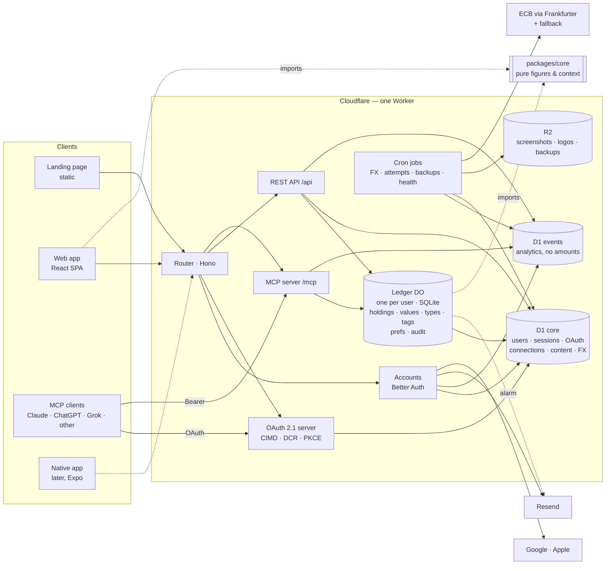

# 03 — Architecture

Status: **awaiting the Founder's approval** (Stage 3 gate) · Stage owner: Staff software engineer
Written 2026-09-27. Inputs: `docs/01-prd.md` (approved as amended, with the §9.6 revisions),
`docs/02-prototype/prototype-notes.md` (approved 2026-09-26), and the Stage 3 asks the Stage 2
handoff named: versioned packs, history pagination, the charting library, the packs admin portal
(PRD §9.6 item 17), each client's connector rules, the native-build rules
(`design-system.md` §9), the Muse logo.

> Designs only what the first phases need (WORKFLOW Stage 3). §7 is the contract Stage 4 plans
> against and Stage 5 builds against; the rest is the reasoning behind it. Where this document
> and the PRD disagree, the PRD wins and this document is wrong — say so.

---

## 1. The shape in one screen

- **One TypeScript codebase, one Cloudflare Worker.** It serves the landing page, the web app, the
  REST API, sign-in, the OAuth server that agents connect through, and the MCP endpoint.
- **Each user's balance sheet is its own database.** A *Ledger* Durable Object per user holds that
  user's holdings, values, types, tags, preferences and audit log in its own SQLite. No query can
  read two users' money, because no database holds two users' money (N4).
- **Everything that is not money** (accounts, sessions, agent connections, packs, exchange rates)
  lives in one D1 database; analytics events live in a second one that holds no amounts (N9).
- **One set of pure functions computes every figure** (`packages/core`): net worth, what you could
  use, periods, carry-forward, the agent's context. The web app, the MCP tools and the native
  apps later all call the same code, so a figure can never differ between screen and agent (N11).
- **The web app and the agent use the same write path.** A REST call and an MCP tool call reach
  the same Ledger method, with the same validation, audit entry and events. No capability is
  UI-only (J6) because there is only one implementation.
- **Packs and agent setup guides are versioned content, not code** (N10): validated documents in
  D1, published from `content/`, readable by the running system, and editable later by an admin
  portal that writes the same rows.
- **Cost:** about **US$6 a month** (US$5 of it Cloudflare) from day one to well past 1,000 users (§9.3). That is not the
  "≈$0" of `00-discovery.md` §5, and it is a decision for the Founder (§13, decision 1).

## 2. What drove it

| Requirement | What it forces |
|---|---|
| **N1** MCP ≥99.5% success, p95 <1.5s | No cold starts. Compute next to the data, so one tool call is one network hop, not five |
| **N4** isolation at the data layer, tested | Structural isolation beats a `WHERE user_id = ?` on every query |
| **N6** ≈$0 → <$50/month, indefinitely, no trial tiers | Permanent free tiers or a flat low price; nothing that bills per idle hour |
| **N8** reliability never traded for cost | No free tier that sleeps, caps requests per day, or cuts CPU below what password hashing needs |
| **N3 / J7** every write auditable and reversible, batches undo together | Transactions around each write and its audit entry; per-user serial writes |
| **N10 / §2.3** packs are versioned data an admin will edit | A content store with versions, validation, audit and a published schema |
| **N11** context is deterministic | Figures come from pure functions with no clock, randomness or inference inside |
| **N7** native iOS/Android later (React Native + Expo, decided 2026-09-23) | One API; domain logic and chart geometry in plain TypeScript the native app can import |
| **§2.3 rule 2** IP country looked up on our own server or CDN | The CDN's own country header, never a browser-side third-party call |

## 3. Client connector facts, checked 2026-09-27

PRD §9 asked Stage 3 to verify each client's current requirements before the architecture locks.

| Client | Custom remote MCP connector | Registration (how the client identifies itself) | Source |
|---|---|---|---|
| **Claude** | **Free, Pro, Max, Team, Enterprise. Free is limited to one custom connector** | CIMD ("Use Claude's published identity", recommended), DCR ("Register automatically"), or a pre-registered client | Claude Help Center, updated 2026-08-11; claude.com connector docs |
| **ChatGPT** | **Plus, Pro, Business, Enterprise, Edu — not Free.** Free accounts can use only apps listed in ChatGPT's directory | CIMD preferred, DCR, or predefined client; PKCE | OpenAI's pages are blocked from this environment; consistent across four independent 2026 guides. **Re-check by hand** |
| **Grok** | Paid tiers, since 2026-05-06 ("Bring Your Own MCP") | Not established | Third-party guides only |
| **Muse** | Unverified: no settings screen; the user asks Muse to add one in chat | Unknown | PRD J5; nothing reachable from here |

**This contradicts the PRD.** §9.5's "Update, Stage 2 review" says ChatGPT's free plan allows custom
MCP connectors. The evidence says it does not. The Founder's own free-plan connections (Notion,
Google Drive) are most likely **directory-listed apps**, which do work on Free. A custom connector
added by URL does not. Consequences:

- A **free ChatGPT user cannot connect NetNet until NetNet is listed in ChatGPT's directory**. That
  listing needs OpenAI's review, and the review time is unknown. Many P-A users are on free
  ChatGPT (PRD §2), so this puts a hard limit on how many of them can ever connect (M3).
- Claude Free works, but gives **one** custom connector. The Claude guide has to say what to do
  when that slot is already taken.
- Claude stays the launch-blocking client (PRD §9, decision 4). Submitting to ChatGPT's directory
  becomes G-D2 work that starts as soon as the MCP layer is stable, not after launch.
- The server is built to the standards below with no client-specific branches, so none of this
  changes the code. It changes the connect guides (content), the directory submissions and the
  PRD's text. **Decision 2 in §13.**

**Protocol.** The current MCP specification is **2026-07-28**. It is stateless (no `initialize`
handshake, no `Mcp-Session-Id`), makes CIMD the preferred way to register, deprecates DCR and
requires RFC 9207 issuer validation. Clients are moving to it at different speeds. So the server
negotiates **2026-07-28, 2025-11-25 and 2025-06-18**, and the OAuth server supports **CIMD and DCR**
(§7.6).

## 4. Stack

| Layer | Choice | Why this, and what it beat |
|---|---|---|
| Language | **TypeScript** everywhere (strict), Node 22 LTS for tooling | One language for web, API, MCP and native (Expo). Validation schemas, domain logic and chart geometry are shared, not re-typed |
| Compute | **Cloudflare Workers**, one Worker, **Workers Paid** ($5/month) | Isolates, not containers: no cold start to fail an MCP call (N1). Edge in Singapore. A flat price that covers 10M requests. *Beat:* Vercel (Hobby is non-commercial, Pro $20/seat), Render/Koyeb free (sleep, then 30s cold starts), Fly/Railway (no permanent free tier), a VPS (one machine, and the Founder runs it) |
| Money data | **Durable Objects with SQLite, one per user** ("Ledger") | Isolation by construction (N4). Compute runs beside the data, so a tool call is one hop (N1). One user's writes are serialised, and real transactions make a write and its audit entry atomic (J6, J7). Alarms schedule each user's reminders (J9). Delete is one call, and 30-day point-in-time recovery is built in. *Beat:* one shared D1 with `user_id` on every row (isolation by convention; batch-only transactions; several cross-region hops per call) and Postgres (no permanent free tier that doesn't sleep) |
| Everything else | **D1** (Cloudflare SQLite): `core` (identity, sessions, OAuth, connections, content, FX) and `events` (analytics) | Relational data that needs lookup across users (by email, by client). 30-day Time Travel. Events kept apart so reading metrics never touches identity or money |
| Files | **R2** | Guide screenshots, agent logos, weekly backups of `core`. 10 GB free, no egress fees |
| HTTP | **Hono** | Small, typed, made for Workers; plain `Request`/`Response` |
| Validation | **zod** (`packages/contracts`) | One schema per contract: it validates REST bodies, defines MCP tool input/output schemas, and types the web client |
| Ledger SQL | **Drizzle ORM** (durable-sqlite driver) + its migrator | Typed SQL, migrations bundled into the Worker and run inside each Ledger |
| Accounts | **Better Auth**: email + password, Google, Apple, email verification, password reset | Runs on Workers with D1. Its session model works for the web app today and for Expo later |
| Agent OAuth | **Better Auth's OAuth 2.1 provider plugin + CIMD package**. We serve the resource-server side ourselves | CIMD, DCR, PKCE and resource-bound tokens without hand-rolled security code. Our own MCP endpoint checks tokens, so no library decides which protocol versions we accept. **Fallback:** `@cloudflare/workers-oauth-provider` (CIMD, DCR, RFC 8707, RFC 9728). The P1 connection spike picks one against live clients |
| MCP | **Official MCP TypeScript SDK**, Streamable HTTP, stateless | The reference implementation, which follows spec changes first |
| Web app | **React + Vite SPA**, React Router, TanStack Query, CSS Modules on design tokens | Everything is behind a login, so there is nothing to server-render. Static assets are free. React is the Expo decision's other half |
| Landing page | **Static HTML/CSS** (its own Vite entry), no framework | A marketing page with its own design (PRD G-D1); nothing to hydrate |
| Charts | **No charting library.** `d3-scale` / `d3-shape` / `d3-array` for the maths, our own SVG components | Answers the prototype's open question (§12). Three chart kinds, all heavily specified (crosshair readout, frosted placeholder, Poster styling). The geometry lives in `core` and draws through `react-native-svg` on native unchanged |
| Email | **Resend** behind an `EmailSender` interface | Permanent free tier (3,000/month, 100/day); $20/month if outgrown. Swappable for Amazon SES |
| Errors | **Sentry** Developer plan (free, permanent), with scrubbing (§10) | Worker and browser errors in one place |
| Analytics | **First-party**: typed server-side events in the `events` D1 | N9 is enforced by the schema, not by reviewing a vendor's autocapture. No tracking SDK ever touches a page that shows money |
| FX rates | **ECB reference rates via Frankfurter**, with a fallback source for currencies the ECB does not publish (VND, TWD, AED…), fetched **once a day into our own table** | Free, no key, history back to 1999. Stored by us, so a user's write never waits on a third party (§6.5) |
| Tests | **Vitest** (unit), **@cloudflare/vitest-pool-workers** (Worker, Ledger and D1 in the real runtime), **Playwright** (E2E) | `CONVENTIONS.md` §9 |
| CI/CD | **GitHub Actions** + `wrangler` | §9 |

**Lock-in, stated honestly.** Workers, Durable Objects and D1 are Cloudflare-only. The way out
is kept open on purpose. The domain logic is plain TypeScript in `core`. The Ledger schema is
ordinary SQLite. REST, OAuth and MCP are open standards. Moving means rewriting the adapters (the
Ledger host, the auth store), not the product.

## 5. Components



### 5.1 Three paths through it

**A web write** (e.g. add a value): SPA → `POST /api/holdings/:id/values` → session cookie gives
`userId` → Ledger stub for `userId` → `recordValues(actor, items)` → one transaction writes the
value rows, the audit entry and the new `data_version` → returns the result, warnings and domain
events → the Worker records analytics events (`value_recorded {source: web}`) after responding.

**An agent read** (J8): client → `POST /mcp` with a Bearer token → the Worker checks the JWT
locally against our own JWKS (issuer, audience = the `/mcp` URL, expiry, scope). No database
lookup → Ledger stub → `context(opts)`, which reads its own SQLite and runs
`core.compileContext()` → the tool result → `agent_tool_called {kind: read, latency_ms}`. That is
**one network hop** after the edge. A client in the US reaching a Ledger in Singapore costs about
200 ms of the 1.5 s budget.

**Connecting an agent** (J5):

```mermaid
sequenceDiagram
  participant U as User (NetNet tab)
  participant W as NetNet web
  participant C as Agent client
  participant S as NetNet server
  U->>W: Connect to agent → Claude, phone
  W->>S: POST /api/agent/attempts {client, entry}
  Note over W: shows the steps; polls the attempt every 2 s
  U->>C: adds connector URL https://‹domain›/mcp
  C->>S: POST /mcp (no token) → 401 + resource_metadata
  C->>S: GET /.well-known/oauth-protected-resource, /oauth-authorization-server
  C->>S: GET /oauth2/authorize (PKCE, resource, client_id = CIMD URL or DCR id)
  S->>U: approval page — the name the client registered with — Allow / Cancel
  U->>S: Allow (email must be verified)
  S->>S: grant → agent_connections row; the attempt becomes "approved"
  W-->>U: moves on by itself ("Connected to Claude")
  C->>S: POST /oauth2/token (code + verifier) → access + refresh token
  C->>S: first tool call → the attempt becomes "live"
```

## 6. Data model

IDs are prefixed ULIDs (`usr_`, `hld_`, `val_`, `typ_`, `tag_`, `aud_`, `bat_`, `con_`, `att_`).
Money is stored as **integers in the currency's minor unit** (ISO 4217 exponent). Value dates are
calendar dates (`YYYY-MM-DD`). Instants are ISO-8601 UTC.

### 6.1 D1 `core` — no money in it

| Table | Key columns | Notes |
|---|---|---|
| `user`, `session`, `account`, `verification` | Better Auth's schema | Email, password hash (scrypt), provider links, `email_verified` |
| `profile` | `user_id` PK, `country` (ISO 3166-1, nullable), `time_zone` (IANA), `segment` (`starting_out`/`accumulating`/`established`/`unknown`), `onboarding_state`, `ledger_location`, `created_at` | What the Worker needs without waking a Ledger: the pack to resolve, the segment every event carries (§3.5), where to resume onboarding (J1) |
| `oauth_client`, `oauth_access_token`, `oauth_refresh_token`, `oauth_consent`, `jwks` | The OAuth plugin's schema | CIMD clients are cached by URL; DCR clients unused for 30 days are purged |
| `agent_connection` | `id` (`con_`, derived from user + client), `user_id`, `client_id`, `client_name`, `registration` (`cimd`/`dcr`/`preregistered`), `created_at`, `first_call_at`, `last_used_at`, `revoked_at` | The Agent tab: client name, time, active (J5). Mirrored into the Ledger (§6.2) so revocation takes effect on the next call |
| `connection_attempt` | `id`, `user_id`, `client`, `entry` (`onboarding`/`home`/`holding`/`agent`), `platform`, `state` (`started`/`approved`/`live`/`failed`), `failed_step`, `started_at`, `updated_at` | Drives "moves on by itself" and `agent_connection_* {entry}`. A cron job times attempts out into a failure step (§7.7) |
| `content_doc` | (`kind`, `key`, `version`) PK, `body` JSON, `sha256`, `author`, `source_commit`, `created_at` | Packs, the country list and agent guides. **Immutable once written** |
| `content_current` | (`kind`, `key`) PK, `version`, `updated_at`, `updated_by` | Which version is live. Rolling back = pointing at an older version |
| `content_audit` | `id`, `kind`, `key`, `from_version`, `to_version`, `actor`, `at` | Who changed the world, when, old → new (§2.3) |
| `fx_rate` | (`date`, `currency`) PK, `per_usd` (decimal string), `source` (`ecb`/`fallback`) | Filled daily by cron; history backfilled once at deploy |

### 6.2 Ledger (one SQLite per user)

| Table | Columns | Notes |
|---|---|---|
| `meta` | `schema_version`, `user_id`, `base_currency`, `data_version`, `created_at` | `data_version` goes up by one on every write. It is the snapshot's ETag |
| `user_type` | `id`, `universal` (§7.8), `pack_type_key` (nullable, e.g. `car_loan`), `custom_name` (nullable), `sort`, `archived` | **No name is stored until the user renames one**, so labels follow the current pack (§2.3) |
| `tag` | `id`, `name` (unique, case-insensitive), `sort` | |
| `holding` | `id`, `name`, `kind` (`asset`/`liability`), `type_id`, `currency`, `cadence_days`, `archived_at`, `created_at`, `row_version`, **`access`** (`accessible`/`illiquid`/`locked`/`undecided`, null for liabilities), **`access_basis`** JSON `{via: default|question|universal|override|not_sure, pack, pack_version, question, answer}`, **`access_reason`**, **`access_until`** | The applied accessibility outcome **and the reason shown for it** are kept as they were applied, with the pack version. A pack edit never moves them (§6.6) |
| `holding_tag` | `holding_id`, `tag_id` | |
| `value` | `id`, `holding_id`, `date`, `amount_minor`, `currency`, `base_minor`, `base_currency`, `fx_rate` (decimal string), `fx_rate_date`, `fx_source` (`ecb`/`fallback`/`same`/`user`/`agent`), `source` (`web`/`agent`/`system`), `client_name`, `connection_id`, `batch_id`, `entered_at`, `updated_at`, `row_version` | **Unique (`holding_id`, `date`)**: same date means last write wins, with a warning (J3). `base_minor` is the stored conversion that totals and periods use (J2, J11) |
| `prefs` | `key` PK, `value` JSON | Home filter, Insights filter and exclusions (these persist, J11), baseline, sort, reminder cadence and opt-out |
| `connection` | `id`, `client_name`, `revoked_at` | Mirror of `agent_connection`, checked on every agent call |
| `audit` | `id`, `at`, `actor` (`user`/`agent`/`system`), `client_name`, `connection_id`, `batch_id`, `action` (e.g. `holding.create`, `value.update`, `type.merge`), `entity`, `entity_id`, `before` JSON, `after` JSON, `undoes`, `undone_by` | One row per entity changed. `before` for a deleted holding includes its values |
| `batch` | `id`, `connection_id`, `opened_at`, `last_write_at`, `closed_at` | One agent turn (§6.7) |

### 6.3 D1 `events`

`event(id, name, at, user_id NULL, visitor NULL, segment, props JSON, app_version)`. `props` is
written only through the typed `track()` (§7.7), so no amount, name or document text can reach
it. `visitor` is `sha256(daily_salt ‖ ip ‖ user-agent)`, truncated. The salt changes daily and is
never stored, so the landing page can count unique visitors (M10) without a cookie. When an
account is deleted, its events are **re-keyed to a random id**: M1–M11 still count them, and they
no longer point at anyone.

### 6.4 Content (packs, countries, agent guides)

- **Source:** `content/packs/*.json`, `content/countries.json`, `content/agents/*.json` in the repo.
  Screenshots and logos go in R2 under `content/…`.
- **Publishing:** `pnpm content:publish --env <env>`. It validates every document against its
  schema (§7.8). Any failure rejects the whole publish: a half-applied pack is a wrong pack. It then
  inserts new `content_doc` versions, moves `content_current` and writes `content_audit`.
  **No code release is involved**, so adding a market ships no release (N10).
- **Reading:** the Worker caches `content_current` for 60 s and each version indefinitely
  (versions are immutable). The web app fetches `GET /api/content/packs/:key@:version`, cached for
  a year.
- **The admin portal (not v1)** will write the same three tables through the same validator. It
  gets a separate `content_admin` role with **no route to any Ledger or to `profile`**. Configuring
  the world grants no access to anyone's balance sheet (§2.3). Nothing in v1 has to change for it.

### 6.5 Money and exchange rates

- **Minor units everywhere below the edges.** Tools and forms take and return decimal amounts in
  major units. The boundary converts using the ISO 4217 exponent and rejects extra precision and
  anything over 10¹⁵ minor units with a specific error (J6).
- **Rate:** the published rate for the value's date (latest on or before it), **looked up once
  when the value is written, stored on the value, and never refreshed** (PRD §9.6 assumption;
  §4.2 reserves automated refresh). Cross rates go through USD. Before the fallback source's history
  begins, the nearest later rate is used and its date recorded. The web and the agent may supply
  their own rate (`fx_source: user|agent`), e.g. the one printed on a statement.
- **Conversion** is decimal arithmetic on integers (no floats), rounded half away from zero. The
  rate and its date are stored, exported and readable by the agent, and not displayed (J2).
- **Changing the default currency** re-derives every value's `base_minor` from the stored rate
  tables at each value's own `fx_rate_date`. That is one logged, undoable `system` migration, so
  periods stay undistorted by later FX (J11).
- If the day's fetch fails, the previous rate stays in use, marked with its date, and an alert
  fires (§10). A write never fails because a rate source is down.

### 6.6 Accessibility and pack versions (PRD §2.3, §9.6 item 17)

`core.resolveAccess(packChain, universal, answer?)` returns `{access, reason, until, basis}`.
**Current pack, then generic, key by key**, exactly as the prototype does. At create or change
time the whole outcome is written onto the holding with the pack's key and version.
Afterwards:

- **Labels follow the current pack** (types store no name).
- **Outcomes and their reasons do not.** A pack edit changes nothing already applied. A later
  re-application is an explicit, logged `system` migration run per Ledger, with an audit entry
  per holding. No such migration exists in v1.
- **Undecided** (`not_sure`) counts toward net worth and never toward what could be used, and it is
  reported to the agent as incompleteness (J2).
- **Moving country** adds the new pack's default types and removes none (J2). Stored outcomes stay
  as they are.

### 6.7 Audit, batches and undo (N3, J7)

- **Every write** runs in one Ledger transaction: the change, one audit row per entity touched,
  `data_version + 1`. Nothing is ever partially written (J6).
- **Batches (one agent turn).** MCP has no turn id, and the 2026-07-28 spec removed sessions. The
  Ledger groups a connection's writes into one batch while each write follows the previous one by
  **≤ 120 s**. A single `record_values` call is always one batch. The Ledger is single-threaded,
  so the grouping is exact. It is a heuristic about turns, and it is tuned by M5 evidence, not guessed.
- **Undo of an entry** restores `before` exactly, and only if the entity is still at the entry's
  `after` (compared by `row_version`). Otherwise the result is `UNDO_CONFLICT`, naming the later
  change that must be undone first. The undo is itself an audit entry (`undoes`), so it can be undone.
- **Undo of a batch** reverts every not-yet-undone entry in the batch, newest first, in one
  transaction. It is all or nothing.
- The user correcting or undoing an agent-written value fires `value_corrected {original_source:
  agent, age_at_correction}` or `value_undone` (M5).

## 7. Interface contracts

### 7.1 URL map (one origin: `https://‹domain›`)

| Path | What |
|---|---|
| `/` | Landing page (static) |
| `/app/*` | Web app (SPA). The OAuth approval page is `/app/connect/approve` |
| `/api/*` | REST API, JSON, cookie session (web); bearer session for native later |
| `/api/auth/*` | Better Auth: sign-up, sign-in (email, Google, Apple), verify email, reset password, sign-out |
| `/oauth2/authorize` · `/oauth2/token` · `/oauth2/register` (DCR) · `/oauth2/revoke` · `/oauth2/jwks` | OAuth 2.1 authorization server |
| `/.well-known/oauth-authorization-server` | RFC 8414 metadata, with `client_id_metadata_document_supported: true` |
| `/.well-known/oauth-protected-resource` (and `/…/mcp`) | RFC 9728 metadata for the MCP resource |
| `/mcp` | **The connector URL users paste.** MCP Streamable HTTP, `POST` only (stateless) |
| `/content/*` | Screenshots and logos from R2 |

### 7.2 REST API (web now, native later)

Errors are always `{"error": {"code", "message", "fields"?: {path: message}}}` (§7.5 codes).
Writes return `{result, dataVersion, warnings: [{code, message}]}`.

| Method & path | Body / query → response | Jobs |
|---|---|---|
| `GET /api/geo` | → `{country: "SG" \| null}` from the CDN's IP country | §2.3 r2 |
| `GET /api/me` · `PATCH /api/me` | profile: `email, emailVerified, country, baseCurrency, segment, timeZone, onboardingState` | J1 |
| `GET /api/snapshot` | `If-None-Match: <dataVersion>` → 304, or `{dataVersion, baseCurrency, packRef, prefs, types, tags, holdings, values}`. Values are compact per holding: `[date, amountMinor, currency, baseMinor, source, clientName, id]` | J4, J11 |
| `POST /api/holdings` | `{name, kind, typeId, currency, tagIds?, access?: AccessInput, opening?: {amount, date, fxRate?}, via: "guided"\|"form", allowDuplicate?}` → `Holding`, or `409 LIKELY_DUPLICATE {candidates}` | J1, J2, J6 |
| `PATCH /api/holdings/:id` | `{name?, typeId?, tagIds?, access?, cadenceDays?, archived?}` | J2 |
| `DELETE /api/holdings/:id` | — | J2 |
| `GET /api/holdings/:id/values` | `?cursor&limit≤200` → `{items, nextCursor}`, newest first | J4 |
| `POST /api/holdings/:id/values` | `{amount, date, currency?, fxRate?}` → warning `SAME_DATE_REPLACED` when it replaces | J3 |
| `PATCH /api/values/:id` · `DELETE /api/values/:id` | `{amount?, date?, currency?, fxRate?}` | J3 |
| `POST /api/types` · `PATCH /api/types/:id` · `DELETE /api/types/:id?moveTo=` | create / rename / delete or merge; holdings follow, nothing orphaned | J2 |
| `POST /api/tags` · `PATCH /api/tags/:id` · `DELETE /api/tags/:id?mergeInto=` | same for tags | J2 |
| `GET /api/activity` | `?cursor&limit≤100` → audit entries, newest first, grouped by batch | J7 |
| `POST /api/activity/:entryId/undo` · `POST /api/activity/batches/:batchId/undo` | → `UNDO_CONFLICT {blockers}` when not possible | J7 |
| `PATCH /api/prefs` | filters, exclusions, baseline, sort, reminders `{cadence, optOut}` | J4, J9, J11 |
| `GET /api/agent/connections` · `DELETE /api/agent/connections/:id` | list · revoke (logged; later calls rejected) | J5 |
| `POST /api/agent/attempts` · `GET /api/agent/attempts/:id` | `{client, entry, platform}` → `{id, state, failedStep?, cause?}` (polled every 2 s while the flow is open) | J5 |
| `GET /api/content/current` · `GET /api/content/:kind/:key@:version` | live version map · an immutable document | §2.3, J5 |
| `GET /api/export?format=json\|csv` | everything: holdings, types, tags, accessibility and the answer behind it, all values with currencies, rates and rate dates | J10 |
| `DELETE /api/account` | needs a sign-in in the last 10 minutes → `{erasedWithinDays: 30}` | J10 |
| `POST /api/events` | client-side events only (§7.7): `{name, props}`, whitelisted | §3.5 |
| `POST /api/reminders/unsubscribe` | signed one-click token (also `List-Unsubscribe`) | J9 |
| `GET /api/health` | D1 and a Ledger ping → `{ok}` | §10 |

**Pagination decision** (prototype §8): anything that can grow without limit pages with an
opaque cursor: values, activity, and the MCP list tools. The web app's `snapshot` is **not paged
in v1**. A heavy P-C (30 holdings × monthly values × 5 years) is about 1,800 values, roughly 30 KB
gzipped, and loading it once makes filters, baselines and Insights instant, with the same `core`
code on the client. **Revisit trigger:** a snapshot over 1 MB gzipped or 20,000 values. The
Worker logs the size of each snapshot it sends.

### 7.3 Ledger (internal RPC between the Worker and each user's Durable Object)

```ts
type Actor = { kind: 'user' | 'agent' | 'system'; connectionId?: string; clientName?: string };
type Write<T> = { result: T; dataVersion: number; warnings: Warning[]; events: DomainEvent[] };

interface Ledger {
  init(i: { userId: string; baseCurrency: string; pack: PackRef }): Promise<void>;
  snapshot(): Promise<Snapshot>;
  context(o: { baseline?: Baseline; today: string; packs: Pack[] }): Promise<FinancialContext>; // §7.5
  listHoldings(q: HoldingQuery): Promise<Page<HoldingView>>;
  getHolding(id: string, values?: PageReq): Promise<HoldingDetail>;
  history(q: HistoryQuery): Promise<Series>;
  periods(q: PeriodQuery): Promise<PeriodTable>;
  activity(p: PageReq & { batchId?: string }): Promise<Page<AuditEntry>>;

  createHolding(a: Actor, i: CreateHolding): Promise<Write<Holding>>;
  updateHolding(a: Actor, id: string, p: HoldingPatch): Promise<Write<Holding>>;
  deleteHolding(a: Actor, id: string): Promise<Write<void>>;
  recordValues(a: Actor, items: NewValue[]): Promise<Write<ValueResult[]>>;   // 1..200, atomic
  updateValue(a: Actor, id: string, p: ValuePatch): Promise<Write<Value>>;
  deleteValue(a: Actor, id: string): Promise<Write<void>>;
  upsertType(a: Actor, i: TypeInput): Promise<Write<UserType>>;
  deleteType(a: Actor, id: string, moveTo?: string): Promise<Write<void>>;
  upsertTag(a: Actor, i: TagInput): Promise<Write<Tag>>;
  deleteTag(a: Actor, id: string, mergeInto?: string): Promise<Write<void>>;
  undo(a: Actor, t: { entryId: string } | { batchId: string }): Promise<Write<UndoResult>>;
  setPrefs(a: Actor, p: PrefsPatch): Promise<Write<Prefs>>;
  changeBaseCurrency(a: Actor, ccy: string): Promise<Write<void>>;
  applyPackTypes(a: Actor, pack: PackRef): Promise<Write<UserType[]>>;
  mirrorConnection(c: { id: string; clientName: string; revokedAt?: string }): Promise<void>;
  exportAll(): Promise<ExportBundle>;
  destroy(): Promise<void>;                     // deleteAll(); the alarm is cleared
  alarm(): Promise<void>;                        // J9 reminders
}
```

Only `apps/worker/src/ledger/**` may touch Ledger SQL (lint-enforced, `CONVENTIONS.md` §3). The
Worker picks the Ledger with `idFromName(userId)`. `userId` comes from the verified session or
token and never from the request body. That one function is the whole isolation boundary, and the
isolation suite (§8) attacks it.

### 7.4 MCP server

**Transport and protocol.** Streamable HTTP at `/mcp`, stateless: every request is authenticated
and served on its own. Protocol versions **2026-07-28, 2025-11-25, 2025-06-18**. Tools declare
`inputSchema`, `outputSchema` and annotations (`readOnlyHint`, `destructiveHint`,
`idempotentHint`, `openWorldHint: false`), and return `structuredContent` plus a short text
rendering. Tool names and parameters are `snake_case`. Amounts are decimal numbers in major units,
always with their currency. Every list is paged. **Server instructions** (a few lines): call
`get_financial_context` first for any question about the user's position; NetNet states facts and
uncertainty, and advice is yours; look for an existing holding before creating one; for a setup
conversation, ask what `get_setup_guide` asks.

**Scopes.** `ledger.read`, `ledger.write`. v1's approval page grants both: PRD §4.2 makes read and
write free and unrestricted. Keeping them separate costs nothing now and allows a read-only
connection later.

**Tools** (`kind` feeds `agent_tool_called`):

| Tool | Kind | Input (main fields) | Returns | Jobs |
|---|---|---|---|---|
| `get_financial_context` | read | `baseline?` (`last_update`/`last_month`/`last_quarter`/`year_start`/`last_year`/`initial`) | §7.5, one call enough to answer | **J8** |
| `list_holdings` | read | `query?, type_ids?, tag_ids?, archived? (exclude\|include\|only), stale_only?, cursor?, limit≤100` | holdings with latest value, as-of, staleness, access | J6, J8 |
| `get_holding` | read | `holding_id, values_cursor?, values_limit≤500` | holding + paged values (provenance on each) | J6, J8 |
| `get_net_worth_history` | read | `from?, to?, interval (month\|quarter\|year\|day), group_by? (none\|type\|access\|currency), type_ids?, tag_ids?` | series; each point marks carried vs observed | J8, J11 |
| `get_period_changes` | read | `view (monthly\|quarterly\|yearly), periods?≤24, drivers?` | period-end value, change, %, top contributors | J11 |
| `get_taxonomy` | read | — | types (label, universal meaning) and tags | J6 |
| `get_setup_guide` | read | `country?` | this country's basics (checklist, follow-ups) and the fact questions per type | J6 |
| `list_activity` | read | `cursor?, limit≤100, batch_id?` | audit entries | J7 |
| `create_holding` | write | `name, kind, type_id \| universal_type, currency, tag_ids?, access_answer? (answer id \| "not_sure"), opening_value? {amount, date?, fx_rate?}, allow_duplicate?` | holding, or `LIKELY_DUPLICATE {candidates}` | J6 |
| `update_holding` | write | `holding_id, name?, type_id?, tag_ids?, access_answer?, cadence_days?, archived?` | holding | J6 |
| `delete_holding` | write · destructive | `holding_id` | — | J6 |
| `record_values` | write | `values: [{holding_id, amount, date?, currency?, fx_rate?}] (1..200)` | per item: value id, replaced?, warnings | **J6** |
| `update_value` | write | `value_id, amount?, date?, currency?, fx_rate?` | value | J6 |
| `delete_value` | write · destructive | `value_id` | — | J6 |
| `upsert_type` | write | `type_id?, name, universal_type?` | type | J6 |
| `delete_type` | write · destructive | `type_id, move_holdings_to?` | — (merge = delete with move) | J6 |
| `upsert_tag` | write | `tag_id?, name` | tag | J6 |
| `delete_tag` | write · destructive | `tag_id, merge_into?` | — | J6 |
| `undo` | write | `entry_id \| batch_id` | what was restored, or `UNDO_CONFLICT` | J7 |

**Deliberately not agent tools:** account deletion, export (a file for the person), revoking
connections, and changing email or password. None are in J6's list, and each is one an agent
should never be able to do on a person's behalf.

**Duplicates** (J6). `create_holding` compares the new holding with existing ones (normalised
name similarity, same kind, same currency, compatible type). It returns `LIKELY_DUPLICATE` with
up to three candidates unless `allow_duplicate: true`. The check is deterministic string
arithmetic, no inference (N11).

### 7.5 `get_financial_context` — the §2.4 layers, and the error codes

Deterministic output of `core.compileContext(ledgerData, packChain, today, options)`. It is
**at most 8 KB of JSON** for any user. Sections come in order of importance, and holdings come
largest first, capped at 25. The rest is summarised by type and pointed to `list_holdings`.

```jsonc
{
  "as_of": "2026-09-27", "currency": "SGD",
  "answer_guide": [                       // answer shape: which figure fits which question
    { "for": "affordability — can I pay for X from what I have", "use": "totals.could_use",
      "never": "totals.net_worth", "note": "undecided and locked money is excluded" },
    { "for": "progress — am I on track, how did I do", "use": "totals.net_worth, change" },
    { "for": "exposure and risk", "use": "exposure" },
    { "for": "debt burden", "use": "totals.owed, owed_to_could_use" }
  ],
  "totals": {                             // arithmetic already done
    "net_worth": 1840250.00, "assets": 2310250.00, "owed": 470000.00,
    "could_use": 1040000.00, "sell_first": 120000.00, "locked": 1150250.00, "undecided": 0,
    "owed_to_could_use": 0.45,
    "change": { "baseline": "last_month", "since": "2026-08-31", "amount": 12400.00, "pct": 0.68 }
  },
  "picture": {                            // provenance and completeness
    "holdings": 12, "stale": 1, "undecided": 0, "without_value": 0,
    "oldest_value_days": 410, "freshness": "some_stale",
    "notes": ["Car value is 410 days old", "NetNet only knows what has been added"]
  },
  "exposure": {
    "by_currency": [{ "currency": "SGD", "share": 0.77 }, { "currency": "USD", "share": 0.23 }],
    "concentration": [{ "holding_id": "hld_…", "name": "HDB flat", "share": 0.41 }]
  },
  "holdings": [                           // meaning, not just names
    { "id": "hld_…", "name": "CPF Ordinary Account", "type": "CPF",
      "meaning": "Mandatory retirement account. Counts toward net worth, never toward what can be spent this month.",
      "access": "locked", "access_reason": "CPF is locked until you’re eligible to withdraw",
      "until": "until you’re eligible to withdraw",
      "value": { "amount": 117100.00, "currency": "SGD", "base": 117100.00, "as_of": "2026-08-04",
                 "age_days": 54, "stale": false, "written_by": "agent:Claude" },
      "change": { "amount": 1400.00, "pct": 1.21 } }
  ],
  "omitted": { "holdings": 0, "hint": "list_holdings returns every holding" }
}
```

It states facts and uncertainty and never what to do (§8, N2). A golden-file test pins the output
byte for byte for fixed inputs (N11).

**Error codes** (REST HTTP status · MCP `isError` result with `structuredContent.error`). Every
message says what to change, for a person or a model to act on:

| Code | HTTP | Meaning |
|---|---|---|
| `VALIDATION_FAILED` | 400 | `fields` names each bad field and the allowed form |
| `OUT_OF_RANGE` | 400 | e.g. an amount with more decimals than the currency allows, or a date far in the future |
| `CURRENCY_UNSUPPORTED` | 400 | not an ISO 4217 code we have rates for; lists the nearest matches |
| `NOT_FOUND` | 404 | also returned for another user's ids. Never "forbidden", which would confirm the id exists |
| `LIKELY_DUPLICATE` | 409 | `candidates: [{id, name, latest}]`; retry with `allow_duplicate` |
| `UNDO_CONFLICT` | 409 | `blockers: [{entry_id, action, at}]` |
| `EMAIL_NOT_VERIFIED` | 403 | connecting an agent before verifying (J1, J5) |
| `SCOPE_REQUIRED` | 403 | token lacks `ledger.write` |
| `REAUTH_REQUIRED` | 401 | account deletion needs a recent sign-in |
| `RATE_LIMITED` | 429 | with `retry_after_s` |
| `INTERNAL` | 500 | with a request id; details go to Sentry, never to the caller |

### 7.6 OAuth for agents (the MCP authorization profile)

- The **resource** is `https://‹domain›/mcp`. An unauthenticated call gets `401` with
  `WWW-Authenticate: Bearer resource_metadata="…/.well-known/oauth-protected-resource"`.
- **Client registration:** CIMD (the `client_id` is an HTTPS URL; we fetch the metadata over
  public HTTPS only, at most 5 KB, cached per its headers for up to 24 h) **and** DCR (RFC 7591),
  rate-limited per IP. Pre-registered clients are possible and unused in v1.
- **Authorization code + PKCE S256 only.** Exact redirect URI match. RFC 8707 `resource` required.
  RFC 9207 `iss` in the response.
- **Approval page** `/app/connect/approve`: needs a signed-in, **email-verified** user. Shows the
  name the client registered with. For a DCR client it adds that NetNet cannot verify the name.
  **Allow** / **Cancel**. `frame-ancestors 'none'`.
- **Tokens:** access tokens are JWTs (signed with our JWKS keys, 1 h, `aud` = the resource, `sub`
  = user, `client_id`, `scope`). Refresh tokens rotate, last 90 days sliding, and are revoked with
  the connection.
- **Revocation** (J5): `DELETE /api/agent/connections/:id` revokes the refresh tokens in D1 and
  mirrors `revoked_at` into the Ledger. The Ledger rejects that connection's next call, whatever
  the remaining life of its access token. An audit entry records the revocation.

### 7.7 Analytics events (§3.5)

One typed function, `track(name, props, ctx)`. Every name has a strict zod schema: unknown props
are rejected, and the only strings allowed are enums or the client name. `segment`, `user_id` and
`app_version` are attached by `track()` itself. **Client-side** events come through
`POST /api/events`, and only the names marked *client* are accepted there.

| Event | Props | Emitted by |
|---|---|---|
| `landing_view` | — (plus `visitor` hash) | client (landing) |
| `signup_started` | `method` | client |
| `account_created` | `method` | server (auth hook) |
| `session_started` | — | client (new session after 30 min idle) |
| `holding_created` | `source`, `via?` (`guided`/`form`, web only) | server (Ledger events) |
| `value_recorded` | `source` | server |
| `value_corrected` | `original_source`, `age_at_correction` (days) | server |
| `value_undone` | — | server |
| `agent_connection_started` | `client`, `entry` | client (connect flow) |
| `agent_connection_completed` | `client`, `entry` | server (approval) |
| `agent_connection_failed` | `step`, `client`, `entry` | server. `authorise`: Cancel or an invalid request. `callback`: the token exchange failed. `discovery`: no authorize request within 15 min of starting. `first_call`: no successful call within 15 min of the token |
| `agent_tool_called` | `tool`, `kind`, `outcome` (`ok`/error code), `latency_ms`, `client` | server (MCP) |
| `insights_viewed` | `view` | client |
| `reminder_sent` · `reminder_clicked` | — | server (Ledger alarm) · server (link redirect) |
| `account_deleted` | — | server |

`ops/metrics/*.sql` computes M1–M11 per segment from this table alone. None of them needs to read
a Ledger, so no metric can read a balance. M12 is a separate benchmark harness (§13, risk 11).

### 7.8 Content schemas

```ts
type Universal = 'cash'|'listed'|'retirement'|'property'|'vehicle'|'equity'|'crypto'
               |'mortgage'|'loan'|'wrapper'|'card'|'other';
type Access = 'accessible'|'illiquid'|'locked';
type Outcome = { access: Access; reason: string; until?: string };

type Pack = {                                    // kind 'pack', key 'generic' | 'sg' | …
  id: string; locale: string | null; currency: string | null;
  labels: Partial<Record<Universal, string>>;    // generic: all required
  examples: Partial<Record<Universal, string>>;
  meaning: Partial<Record<Universal, string>>;   // what the agent is told a type is (§2.4 semantics)
  cadenceDays: Partial<Record<Universal, number>>; // expected update cadence, for staleness (J9)
  defaults: Partial<Record<Universal, Outcome>>;
  questions: Partial<Record<Universal, { ask: string; answers: ({ id: string; label: string } & Outcome)[] }>>;
  types: { key: string; u: Universal; label: string; example?: string }[];
  checklist: { id: string; u: Universal; type?: string; name: string; ask: string; amount: string;
               answer?: string; onlyIf?: string; hint?: string }[];
};
type Countries = Record<string /* ISO 3166-1 alpha-2, plus XK */, { currency: string; pack?: string }>;
type AgentGuide = {                              // kind 'agent', key 'claude' | 'chatgpt' | …
  id: string; name: string; logo?: string; listed: boolean; order: number;
  plans?: string;                                // e.g. "Needs ChatGPT Plus or above" (shown)
  prefillUrl?: string;                           // e.g. https://claude.ai/new?q={prompt}
  platforms: Partial<Record<'phone'|'computer'|'any', { steps: { text: string; image?: string; prompt?: string }[] }>>;
};
```

Validation rules (all enforced by `content:publish`): generic defines every `labels`, `meaning`,
`cadenceDays` and the `other` question. Every `onlyIf` names an earlier checklist item. Every
`type` names a pack type. Answer ids are unique within a question. Every country's currency is
ISO 4217. No two packs share an id. The prototype's `packs.js` is the starting content: generic,
SG, MY, GB. The other seven launch packs are content work, each reviewed by someone who knows the
market (PRD §2.3).

### 7.9 `packages/core` (pure; the functions everything else calls)

```ts
toMinor(amount: string | number, ccy: string): number | Err;  // safe integer; |x| ≤ 10¹⁵
fromMinor(minor: number, ccy: string): string;
convert(minor: number, rate: string /* decimal */): number;   // exact (BigInt inside), half away from zero
resolveAccess(chain: Pack[], u: Universal, answer?: string): Outcome & { basis: AccessBasis };
latestValues(values, asOf): Map<HoldingId, Value>;             // latest by date wins (J3)
position(holdings, latest, filter?): Position;                 // could use / sell first / locked / undecided / owed
series(values, holdings, range, interval, filter?): Point[];    // carried vs observed (J11)
periods(values, holdings, view, filter, exclusions): Period[];  // value dates only; stored base
baselineChange(series, baseline, today): Change;
staleness(holding, latest, today, pack): { stale: boolean; days: number };
compileContext(data, chain, today, opts): FinancialContext;     // §7.5
likelyDuplicates(existing, candidate): Candidate[];
chart: { scales, linePath, bars, stacked, ticks(n, width), nearestPoint(x) };  // web + native
```

No `Date.now()`, no randomness and no I/O in `core`. `today` and ids are passed in (N11).

## 8. Auth and security

| Concern | Approach |
|---|---|
| **Isolation (N4, J10)** | A Ledger per user (§4). `userId` only ever comes from a verified session or token. **Isolation suite:** users A and B; every REST route and every MCP tool is called as B with A's ids and must answer `NOT_FOUND` with none of A's marker strings in the body. A registry test fails the build when a new route or tool has no isolation case |
| Web sessions | HttpOnly, Secure, `SameSite=Lax` cookie. Origin check on every state-changing request. Sessions last 30 days, sliding |
| Passwords | scrypt (Better Auth). At least 8 characters, no composition rules (decided 2026-09-25). Rate-limited sign-in and reset. Reset never reveals whether an account exists |
| Providers | Google and Apple through Better Auth, using each provider's **official sign-in buttons** (prototype note 29). Apple needs a paid Apple Developer account (§13, decision 3) |
| Agent access | §7.6. Short-lived audience-bound JWTs, PKCE, CIMD fetches over public HTTPS only, approval page not frameable |
| Rate limits | Workers rate-limiting binding: sign-in 10/min per IP+email, sign-up 5/min per IP, DCR 10/hour per IP, MCP 120/min and 5,000/day per connection, `record_values` 200 items per call |
| Headers | Strict CSP (self, self-hosted fonts, the Sentry ingest host), HSTS, `X-Content-Type-Options`, `Referrer-Policy: strict-origin-when-cross-origin`, `frame-ancestors 'none'` |
| Secrets (N5) | `wrangler secret` per environment; `.dev.vars` locally (gitignored; `.dev.vars.example` lists names only); CI holds only the Cloudflare deploy token. `CONVENTIONS.md` §7 |
| Data at rest | Cloudflare encrypts D1, Durable Object and R2 storage. No field-level encryption in v1 (§13, risk 9) |
| Privacy in pipelines (N9) | Typed `track()` (§7.7), a whitelisted `log()` (§10), Sentry scrubbing, and reminder emails that carry a count, never an amount. `CONVENTIONS.md` §6 |
| Prompt injection | Holding and tag names are user text returned to agents. They are always JSON string values in `structuredContent`, never instruction text; tool descriptions never interpolate user data |
| Deletion (J10) | `DELETE /api/account` destroys the Ledger, then deletes identity, sessions and OAuth grants (revoking every connection) and re-keys events. **Stated window: 30 days**, the life of the point-in-time backups. Shown to the user before they confirm |
| Content admin (future) | Its own role and routes, with no Ledger binding reachable from them (§6.4) |
| Dependencies | Lockfile, Renovate weekly, `pnpm audit` in CI. No analytics or tracking SDKs, ever |

## 9. Deployment and environments

### 9.1 Environments

| Env | Where | Data | Deployed |
|---|---|---|---|
| **local** | `wrangler dev` (Miniflare simulates Workers, DOs, D1, R2) | Throwaway, fictional seed | Developer machine or Claude Code session |
| **staging** | `staging.‹domain›`, Worker `netnet-staging` | Its own D1s, R2 bucket and DO namespace; fictional data only | Every push to `main`, and on demand from any branch |
| **production** | `‹domain›`, Worker `netnet` | Real users | Manually (GitHub Actions `workflow_dispatch`, Founder) from a green `main` commit |

D1 and Durable Objects get location hint **`apac`**, set from `profile.country` when the Ledger is
created, so a UK user's Ledger can live in Europe later without a migration.

### 9.2 Pipeline

1. **Every push / PR:** install → lint → typecheck → unit → Worker integration (workerd, incl.
   isolation suite and MCP contract tests per protocol version) → build → Playwright E2E against
   `wrangler dev` → content validation.
2. **Deploy:** apply D1 migrations (expand-only, backward compatible) → `wrangler deploy` →
   smoke tests (health, OAuth metadata, an MCP `tools/list` with the probe account) → on failure,
   `wrangler rollback` to the previous version.
3. **Ledger migrations** are bundled and run in each Ledger the first time it wakes after a
   deploy, additive only. Each migration is tested by upgrading fixture databases from every
   earlier schema version (`CONVENTIONS.md` §10).
4. **Content** publishes separately (`pnpm content:publish`), with no code deploy.
5. **Backups:** D1 Time Travel and Ledger point-in-time recovery (30 days each), plus a weekly
   logical export of `core` to R2.

### 9.3 Running cost

| Item | 0–100 users | ~1,000 users |
|---|---|---|
| Cloudflare Workers Paid (Workers, DOs, D1, logs, rate limits; includes 10M requests, 1M DO requests, 25B D1 row reads) | $5.00 | $5–10 |
| R2 (screenshots, backups) | $0 (10 GB free) | $0 |
| Resend | $0 (3,000/month) | $0–20 |
| Sentry Developer | $0 | $0 |
| Domain (Cloudflare Registrar, at cost) | ~$1 | ~$1 |
| **Total** | **≈ $6/month** | **≈ $6–31/month** (ceiling $50 ✓) |
| *If Apple sign-in ships:* Apple Developer Program | +$8.25 ($99/yr) | +$8.25 |

No line is a trial or introductory tier (N6). The Workers Free plan was rejected. Its 10 ms CPU
per request cannot hash a password, and its 100,000 requests/day cap fails requests outright
instead of billing. Both are N8 failures.

## 10. Observability

| What | How | Retention |
|---|---|---|
| Logs | Workers Logs; JSON through `log(event, fields)`, which accepts only whitelisted fields: request id, route, tool, status, latency, user id, connection id, error code. **Never** amounts, names, emails or bodies | 7 days |
| Errors | Sentry (`@sentry/cloudflare` in the Worker and Ledger, `@sentry/react` in the web app). `sendDefaultPii: false`; `beforeSend` drops bodies, query strings and breadcrumb text. **No session replay** | 30 days (free plan) |
| Product analytics | `events` D1 + `ops/metrics/*.sql` → `pnpm metrics --env production` prints M1–M11 per segment | 13 months raw, then aggregates |
| N1 SLO | From `agent_tool_called`: success rate and p95 latency over rolling 7 days. A daily cron emails the Founder only on breach | — |
| Uptime | An external free monitor on `/api/health` and the OAuth metadata. An hourly CI job runs a real MCP `tools/list` + `get_financial_context` with a probe account holding fictional data | — |
| FX fetch | A failed daily fetch alerts the same way; values keep using the last rate, with its date | — |
| Snapshot size | Logged per request, for the §7.2 revisit trigger | 7 days |

## 11. Native path, and the three native-build rules

- Expo reuses: `packages/contracts` (types, validation), `packages/core` (every figure and the
  chart geometry), the REST API with **bearer sessions** (Better Auth's Expo support), and
  `packages/tokens` (the design tokens the web's CSS variables are generated from).
- The brand/native boundary stands (decided 2026-09-23): **we own everything that displays data,
  and all colour and type; the platform owns everything that takes input by gesture.**
- `design-system.md` §9 item 2 asked for three rules. They are:
  1. **Platform sheets, switches, pickers and date fields take the palette, not the outline
     treatment.** Tint and text tokens go through each control's own tint API. No 2px outlines or
     hard offset shadows are drawn on a platform control. Our own surfaces (rows, cards, the
     ledger) keep the full Poster treatment.
  2. **Unbounded follows the reader's text size up to 1.5× for display figures, then gives way.**
     Above that, display figures switch to Space Grotesk Bold at the same size, because
     Unbounded's width wraps a large total. Body text scales without a cap (N7).
  3. **Frosted placeholders use a real blur where the platform draws one** (iOS; Android 12 /
     API 31+) **and the solid veil token otherwise.** It is decided by capability at runtime, never
     by a list of devices.
- **Muse's logo** (`agents/README.md`) is still missing. It needs Meta's press file, added by hand.
  In production it is content (`content/agents/muse.json` + R2), so adding it later needs no
  release.

## 12. The Stage 3 asks, answered

| Ask (from) | Answer | Where |
|---|---|---|
| Version packs; keep the applied reason with the outcome (prototype §8) | Immutable `content_doc` versions + `content_current`; outcome, reason and pack version stored on the holding | §6.4, §6.6 |
| Page the value history? (prototype §8) | Yes for values, activity and MCP lists (cursor). The web snapshot is unpaged, with a revisit trigger | §7.2 |
| Charting library (prototype §8) | None: d3 maths + own SVG, geometry in `core`, shared with native | §4, §7.9 |
| Packs admin portal must stay possible (PRD §9.6 #17, N10) | Same tables, same validator, separate role with no route to user data | §6.4 |
| Verify client connector rules; do free plans allow custom MCP? (PRD §9, §9.5) | Claude Free yes (one connector); **ChatGPT Free no**; Grok paid. Raised as a PRD correction | §3, §13 |
| FX source (PRD §9.6 assumption) | ECB via Frankfurter + a fallback, stored daily; rate at the value's date, fixed at write | §6.5 |
| IP → country on our own server/CDN (PRD §2.3 r2) | `request.cf.country` → `GET /api/geo` | §7.2 |
| Native-build rules (`design-system.md` §9) | Three rules | §11 |
| Muse logo (`agents/README.md`) | Still open. Content, not code | §11 |

## 13. Risks and trade-offs

| # | Risk / trade-off | Mitigation |
|---|---|---|
| 1 | **Cost is ~$6/month, not ≈$0**, at 0–100 users | The price of N8 (§9.3). Decision 1 |
| 2 | **ChatGPT Free cannot connect** until NetNet is listed in ChatGPT's directory; review time is unknown | Claude stays launch-blocking; submit to the directory as soon as the MCP layer is stable; `plans` line in the ChatGPT guide; M3 read per client. Decision 2 |
| 3 | Claude Free allows **one** custom connector | The Claude guide covers "already using your one connector"; measured through `agent_connection_failed {step}` |
| 4 | **MCP protocol churn** (2026-07-28 is new; clients are mid-migration) | Negotiate three versions; contract tests with the SDK client for each; the P1 spike connects real Claude and ChatGPT before anything else is built on it |
| 5 | **Auth library maturity** (OAuth provider + CIMD in Better Auth are recent) | Our resource server is standard JWT checks; a named fallback library; the spike decides |
| 6 | **Durable Objects are less boring than one database**; migrations run per Ledger | Additive migrations only, fixture-upgrade tests from every version, a Sentry alert on any Ledger migration error. Accepted for isolation and latency (§4) |
| 7 | Cloudflare lock-in | Pure `core`, SQLite schema, open protocols (§4) |
| 8 | Agent → Ledger distance (US clients, APAC Ledgers ≈ 200 ms) | One hop per call; measured by `latency_ms`; well inside 1.5 s |
| 9 | No field-level encryption | Provider encryption at rest, structural isolation, no amounts outside Ledgers. Revisit before any B2B or advisor feature |
| 10 | FX fallback source is community-run | Rates stored by us; users and agents can supply a rate; alert on fetch failure |
| 11 | **M12 (context lift) needs a harness and paid model calls** | Built in a later phase: a fixed fictional dataset, the same data exported as a spreadsheet, a weak model through the API, blind scoring. The API spend is outside N6's running cost; the Founder approves each run |
| 12 | The agent-turn heuristic (≤120 s gap) may split or merge turns | One `record_values` call is always one batch; tune with M5 and support evidence |
| 13 | Undo conflicts can surprise | The conflict names the blocking change, and it can be undone first |
| 14 | Pseudonymised events after deletion | Checked in Stage 8's legal pass (privacy policy wording) |

### Decisions needed from the Founder

1. **Running cost of about $6/month from day one** (Workers Paid + domain) instead of ≈$0.
   *Recommended: accept.* The free plan cannot hash passwords and fails requests past a daily cap.
2. **Correct PRD §9.5 on ChatGPT.** Free ChatGPT cannot add a custom connector. Submit NetNet to
   ChatGPT's directory as P1/P2 work (G-D2), and have the ChatGPT guide say which plans work
   until it is listed. *Recommended: accept, and re-check OpenAI's help page yourself, since it is
   blocked from here.*
3. **Apple sign-in costs $99/year** (Apple Developer Program), needed for iOS anyway.
   *Recommended: accept, and enrol early. Approval can take days.*
4. **Grok on the agent list.** Third-party sources say Grok's paid tiers accept custom MCP since
   May 2026. *Recommended: list it once the P1 spike connects it for real, per J5's rule.*
5. **One Durable Object per user**, rather than one shared database with per-row scoping.
   *Recommended: accept*, for isolation and latency (§4, risk 6).
