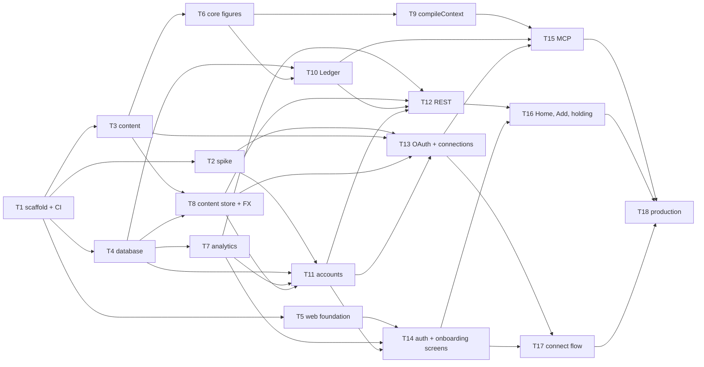

# 04 — Plan

Status: **approved** · Stage owner: Software engineering manager
Inputs: `docs/01-prd.md` (§6 acceptance criteria), `docs/03-architecture.md`, `CONVENTIONS.md`

> Phases are vertical slices, each ending in a checkpoint deployed to production that the Founder
> can use. Only P1 has task briefs (`docs/phases/P1/tasks/`). Later phases stay outlines until they
> are reached, and are planned then (WORKFLOW Stage 4).

---

## 1. How v1 is delivered

Five phases. The riskiest assumption goes first: that a person can connect Claude or ChatGPT to
their own balance sheet, ask it something, and let it write (A1, A2, A4). Everything the experiment
depends on (the MCP layer, the §3.5 analytics, the distribution assets) comes before Insights, which
is built last (PRD §4.1).

**Rules that hold in every phase**

1. **Every phase ends on production**, on the Founder's domain, deployed by the manual workflow
   (architecture §9.2). Until launch, production is unannounced and `/` is a holding page.
2. **A capability lands in the Ledger, REST and MCP in the same phase.** Its screen may follow in a
   later phase. There is one implementation, so the agent is never behind the UI (J6).
3. **Every event a phase's flows fire is wired in that phase.** §3.5 is the experiment, not a
   finishing touch.
4. **Additive endpoints, fields, parameters or message kinds that the architecture implies** (for
   example, the approval page's API) are added to architecture §7 by the build and listed in the
   task report. Any other change to §7 is stop-and-raise (CONVENTIONS §12).
5. **Launch (Stage 8) needs all five phases approved.**

## 2. Phases at a glance

| Phase | Slice | Checkpoint (on production) | Jobs |
|---|---|---|---|
| **P1** | **Ask your agent about your real position** | Sign up by email, confirm the country, add holdings by hand and see what you could use; connect Claude or ChatGPT in one flow; the agent answers from `get_financial_context` and writes values that appear in the app, marked as its own. Instrumented, isolated, backed up, probed | J1–J3 (core), J5, J6, J8; J10 isolation |
| **P2** | **Worth using on its own** | Google and Apple sign-in; onboarding's start screen and the basics; the full Home (trend, allocation, baseline, filters, staleness, the agent handoff); the full holding page; types and tags | J1–J5 (rest), J9 |
| **P3** | **Trust, ownership and the comeback** | Activity with undo of an entry or an agent turn; settings (currency, country); export and account deletion; the comeback reminder by web push or email; the security email's retries | J2 (country change), J7, J10, J12 |
| **P4** | **Ready to launch** | The landing page; the metrics per segment; usage and SLO alerts; all ten packs reviewed; guides and directory listings ready; the launch note; the M12 harness | G-D1–G-D4, M12, packs |
| **P5** | **Insights** | Monthly, quarterly and yearly change with drivers, filters and exclusions; `get_period_changes` | J11 |

## 3. P1 — Ask your agent about your real position

### 3.1 Checkpoint

On `https://‹domain›`, deployed by the production workflow:

1. A visitor signs up with an email and a password and is asked nothing else. They carry on
   unverified while the verification email goes out.
2. Onboarding asks where they live (inferred from the IP on our server, confirmed with one tap, any
   country from an alphabetical list) and, optionally, their segment. They land on Home.
3. They add holdings with the Add form: an asset or a liability, any currency, accessibility settled
   by a fact question, a pack default with its reason, or "Not sure". Home shows net worth and what
   they could use, what is locked (and until when) and what they owe.
4. From the Agent tab they connect Claude or ChatGPT (or any MCP agent through "Other agent") in one
   flow: steps for their platform, NetNet's approval page, and NetNet moving on by itself. The
   security email arrives.
5. In the agent they ask "what am I worth?" or "can I afford a S$120K car?" and get an answer built
   on `get_financial_context`. They hand it a statement and it creates holdings and records values,
   which appear in the web app with a quiet agent mark and the client named on the value.
6. Revoking the connection rejects the agent's next call.
7. Every step fires its §3.5 event with `segment`. The RLS and isolation suites pass in CI. Daily
   encrypted backups run, and a probe exercises the MCP path every 6 hours.

### 3.2 Acceptance criteria in P1

Stage 6 tests P1 against these criteria (PRD §6). The rest of each job waits for the phase named.

| Job | In P1 | Waits |
|---|---|---|
| **J1** | Sign-up by email and password asks nothing else · verification email sent, the user carries on · returning user resumes onboarding or goes to Home · one holding with a value → a total equal to it · a first picture with no agent states something the user did not type (could use, locked and until when, owed) · signup events carry no amounts · unverified users use the app but cannot connect an agent · segment recorded by one skippable question and carried by every event | Google and Apple (P2) · the "Let's start" screen, the basics, Skip, Back and the P-A walk-through (P2) · the agent route from onboarding and the blank Home after it (P2) · the empty Home's full rule, with and without an agent (P2) |
| **J2** | Add an asset or liability (name, type, currency, value, date; tags wait) · liabilities subtract · accessibility recorded in one of four states · asked as a fact, never a category · no-doubt types set with the pack's reason, overridable · generic pack for unpacked markets · country inferred, confirmed, alphabetical, currency default · pack types added on confirmation · instruments from any country · consequence shown, changeable from the holding · never blocks saving, asking the agent offered · "Not sure" → undecided, marked, with a way to decide · foreign currency stores original, conversion, rate and rate date | Tags; add, rename, merge and delete types and tags; archive; delete from the web (P2) · changing country afterwards (P3) · a delete shown in the audit log (P3) |
| **J3** | Add a dated value, back-dated allowed, latest by date drives the total · same date: last write wins, with a warning · `value_recorded {source}`; `value_corrected` when an agent corrects a value | Editing a value on the web (P2) · the edit shown in the audit log (P3) |
| **J5** | Everything except the handoff prompts: steps per client and platform with screenshots and the connector URL, no token · "Other agent" · Back step by step · the Connect button's logos · the same flow from the Agent tab and the empty Home · verify first, with resend, moving on by itself · approval moves NetNet on by itself · connection shown active with client name and time · failures fire `agent_connection_failed` and show a plain cause and retry · revoke rejects later calls · the security email · M9 readable | Entries from onboarding and a holding (P2) · the prompt handoff for an empty or stale Home (P2) · the revocation shown in Activity (P3) |
| **J6** | All, except undo (P3) | — |
| **J8** | All, except the blind comparison (M12, P4) | — |
| **J10** | No screen or API response carries another user's data, verified by test | Export and deletion (P3) |

Non-functional requirements from P1: N1 measured (`latency_ms`) and probed, N2, N3 (audit rows on
every write; undo in P3), N4, N5, N7, N8, N9, N10, N11.

### 3.3 Tasks

Briefs: `docs/phases/P1/tasks/P1-T1.md` … `P1-T18.md`. Founder items are in §5.

| Task | Title | Depends on | Parallel-safe | Founder items first |
|---|---|---|---|---|
| P1-T1 | Scaffold the monorepo, CI and preview deploys | — | no | F4, F5 |
| P1-T2 | Spike: real Claude and ChatGPT over OAuth to a stateless MCP server | T1 | yes | F7, F8 |
| P1-T3 | Content: schemas, starting packs, countries and agent guides | T1 | yes | — |
| P1-T4 | Database: schemas, roles, row-level security and `withUser` | T1 | yes | F7 |
| P1-T5 | Web foundation: tokens, app shell and base components | T1 | yes | — |
| P1-T6 | Core figures: money, accessibility, position, staleness, series, duplicates | T3 | yes | — |
| P1-T7 | Analytics: `track()`, the event schemas and the client events endpoint | T4 | yes | — |
| P1-T8 | Content store and exchange rates | T3, T4 | yes | F9 |
| P1-T9 | Core: `compileContext`, the agent's context | T6 | yes | — |
| P1-T10 | Ledger module (P1 surface) | T4, T6 | yes | — |
| P1-T11 | Accounts: sign-up, verification, sessions, profile and `notify()` | T2 (verdict), T4, T7, T8 | yes | F2, F10 |
| P1-T12 | REST API (P1 surface) | T7, T8, T10, T11 | yes | — |
| P1-T13 | Agent OAuth server and connections | T2 (verdict), T3, T8, T11 | yes | — |
| P1-T14 | Web: sign-up, sign-in and onboarding screens | T5, T7, T11 | yes | — |
| P1-T15 | MCP server and tools | T9, T10, T13 | yes | — |
| P1-T16 | Web: Home, Add and the holding page | T12, T14 | yes | — |
| P1-T17 | Web: the Agent tab and the connect flow | T13, T14 | yes | F11 |
| P1-T18 | Production: deploy, observability, backups and probe | T15, T16, T17 | no | F12–F16 |

"Parallel-safe" means the task can run beside the others in its wave once its dependencies are
done; tasks in one wave touch different files.

### 3.4 Order

| Wave | Tasks |
|---|---|
| 1 | T1 |
| 2 | T2, T3, T4, T5 |
| 3 | T6, T7, T8 |
| 4 | T9, T10, T11 |
| 5 | T12, T13, T14 |
| 6 | T15, T16, T17 |
| 7 | T18 (its setup parts, such as Sentry, headers and the backup workflow, can start after T4) |

**The spike gates the auth work.** T2 needs about 45 minutes of the Founder's hands-on time: adding
the spike's URL as a connector in Claude and in ChatGPT, on a computer and a phone. Waves 3 and 4
carry on meanwhile, but T11 and T13 start only after T2's verdict. If the verdict takes one of the
architecture's stated fallbacks (a standalone OAuth library; GitHub Actions for scheduled runs), it
is recorded in `decisions.md`. Anything beyond them comes back to the Founder.

### 3.5 Running the build

- `stage: build P1` in a new session. The build session works wave by wave, dispatching one
  engineer subagent per task, and hands off to a new session between waves when its context runs
  heavy (STATE names the next wave). `stage: build P1-Tn` runs a single task.
- One branch and one pull request per task (CONVENTIONS §15). Every pull request gets its own
  preview, with its own Neon branch, from T1 and T4 onward.
- After T18, `stage: test P1` in a fresh session (WORKFLOW Stage 6), against §3.2.

## 4. Later phases (outlines)

Each is planned in detail, with task briefs, when it is reached.

### P2 — Worth using on its own

**Checkpoint:** someone who never connects an agent gets a complete, useful app. Sign-up by Google,
Apple or email. Onboarding's "Let's start…" screen opens the basics, with the agent as the second
route. Home shows the whole picture, and hands stale or missing numbers to a connected agent.

**Criteria:** the rest of J1, J2, J3 and J5 (see §3.2 "Waits"), all of J4 and J9.

**Tasks (outline):**
- Google and Apple sign-in with the official buttons; `method` on the sign-up events.
- Onboarding's start screen and the basics: the pack's checklist, follow-ups only after a yes, each
  answer saved at once, Skip, Back (a no removes what the yes added, logged), "Done for now",
  `via: guided`, resume. The agent route from onboarding.
- Chart geometry in `core.chart` and the SVG components: the trend read by hover, tap, drag and
  arrow keys; the frosted "Need more data" placeholder; allocation; assets vs liabilities.
- Home complete: trend and allocation (carousel on a phone), breakdown by type, assets vs
  liabilities, baseline selector, sort, filter and Don't Show, the stale count, the agent handoff
  (starting prompt, update prompt, prefill or Copy), the empty-Home rule with and without an agent.
- The holding page complete: trend, change over the baseline, paged history, edit and delete a
  value, archive and unarchive, delete, tags. The connect entry from a holding.
- Types and tags: add, rename, merge, delete; tags in the Add form.
- Staleness labels on list and detail (J9).
- A sweep of every J1–J4 and J9 happy path at 390 and 1280 px, 320 px without sideways scrolling,
  axe, tap targets and minimum text size.

**Founder items:** F17 Google, F18 Apple.

### P3 — Trust, ownership and the comeback

**Checkpoint:** everything an agent or the person changed is visible and reversible. The person can
take their data away or delete it. Someone away for a month gets one gentle reminder, by push where
they turned it on and by email otherwise.

**Criteria:** all of J7, J10 and J12; J2's country change and the delete in the audit log; J3's
edit in the audit log; J5's revocation in Activity.

**Tasks (outline):**
- Ledger `activity`, `undo` (entry and batch, `UNDO_CONFLICT` naming the blocker); REST
  `/api/activity*`; MCP `list_activity` and `undo`; `value_undone`, `value_corrected`.
- The Activity screen: newest first, grouped by agent turn, undo of an entry or a turn.
- Settings: default currency (re-derived from stored rates as one undoable `system` change),
  country (adds the new pack's types, removes none), sign-out.
- Export (JSON and CSV) and account deletion (a recent sign-in, the 30-day window stated first,
  every connection revoked, events re-keyed, `account_deleted`).
- The comeback reminder: `reminder_state` with a backfill, `touchChecked` on session API calls and
  MCP `tools/call`, the three daily runs with the claim, 08:00–21:00 local, the 60-a-day email cap,
  the email with one-click unsubscribe, opened tracking. Security-email retries move into the runs.
- Web push: VAPID, the endpoints API, a service worker that handles `push` and `notificationclick`
  only, the Home card, Settings → Notifications, the device lifecycle, the push events.

**Founder items:** F19 VAPID keys and the link-signing secret; a real iPhone (NetNet on the Home
Screen) and an Android phone for Stage 6's manual push check (architecture §12 risk 16).

### P4 — Ready to launch

**Checkpoint:** everything the launch needs except the go-live itself (Stage 8): the landing page
live, the metrics readable per segment, the free-tier limits watched, ten packs reviewed, and the
listings and launch note ready to submit and post.

**Criteria:** PRD §3.4 G-D1–G-D4, §3.5 `landing_view`, the M12 comparison in J8, §2.3's ten packs.

**Tasks (outline):**
- The landing page (G-D1): its own design, §2.5's statement with both proofs, the screen recording
  (fictional data), the call to action straight to sign-up; `landing_view` with the cookie-less
  `visitor` hash.
- Measurement (G-D4): `ops/metrics/*.sql` for M1–M11 and M13 per segment (M13 per channel), run as
  `netnet_metrics`; `pnpm metrics --env production`; the M10 funnel.
- Operations: the daily health cron (Neon usage, the N1 SLO from events, the day's email count, a
  security email unsent for 24 hours), emailed to the Founder at the architecture §9.4 triggers; the
  FX failure alert.
- The seven remaining launch packs (ID, PH, TH, VN, HK, IN, AU), and all ten reviewed by someone who
  knows each market, the reviewer named in each publish message.
- Agent guides checked against the clients' current screens; listing materials for Claude's and
  ChatGPT's directories and the public MCP registries (G-D2). Submitting them needs the privacy
  policy and terms (Stage 8's legal basics).
- The launch note (G-D3): one text, the proof varied per audience.
- The M12 harness: a fixed fictional dataset and question set, a deliberately weak model, NetNet
  versus a spreadsheet upload, scored blind. Each run's API spend is approved by the Founder first.

**Founder items:** F20–F23.

### P5 — Insights

**Checkpoint:** Insights per J11 on production, on the web and through `get_period_changes`.

**Tasks (outline):**
- `core.periods`: calendar periods from value dates, carried vs observed, each entry's stored
  conversion, drivers ranked by contribution, filters and exclusions; golden tests.
- The Insights screen: Monthly, Quarterly and Yearly; a period's drivers; its own filters and Don't
  Show, persisted; placeholders and the single "what's needed" statement; `insights_viewed`.
- `Ledger.periods` and the MCP tool `get_period_changes`.

## 5. Founder setup checklist

Each item sits before the first task that needs it. **Secrets go straight into Vercel or GitHub
settings, never into chat or a file.** Generate a random secret with `openssl rand -base64 32`.
"Vercel env" means the project's Environment Variables, for Production and Preview unless noted.

**Start now (long lead times)**

| # | Item | Needed by |
|---|---|---|
| F1 | Enrol in the Apple Developer Program ($99/year; approval can take days) | P2 (Sign in with Apple) |
| F2 | Buy the domain | P1-T11 (email DNS), P1-T18 |
| F3 | Find a reviewer who knows each launch market: SG, MY, ID, PH, TH, VN, HK, IN, AU, GB | P4 |

**Before `stage: build P1` (T1, T2, T4)**

| # | Item | Needed by |
|---|---|---|
| F4 | **Vercel:** a Hobby account linked to GitHub, and a project for `terrence0488/netnet`. Turn **off** Vercel Authentication for Preview deployments (agents must reach a preview's `/mcp`; previews hold fictional data only). Create a token. GitHub → Settings → Secrets and variables → Actions: secrets `VERCEL_TOKEN`, `VERCEL_ORG_ID`, `VERCEL_PROJECT_ID` | T1 |
| F5 | **Cloud environment network access:** in this environment's settings (the environment menu in the session's title bar → Edit → Network access), allow Vercel and Neon: `vercel.com`, `api.vercel.com`, `*.vercel.app`, `console.neon.tech`, `*.neon.tech` | T1, T2, T4 |
| F6 | After T1 merges: protect `main` so the CI check must pass before a merge, and install the free **Renovate** GitHub app (github.com/apps/renovate) on this repository only, so library updates arrive as weekly pull requests | T2 onward |
| F7 | **Neon:** projects `netnet-prod` and `netnet-preview`, region AWS Singapore (`aws-ap-southeast-1`), **Postgres 17**, compute 0.25 CU. In each, a role `netnet_owner` (made in the console). GitHub secrets: `NEON_API_KEY`; `DATABASE_OWNER_URL` (prod, `netnet_owner`, direct connection); `NETNET_APP_DB_PASSWORD_PROD` and `NETNET_APP_DB_PASSWORD_PREVIEW`, two different values from `openssl rand -hex 32` (letters and digits only, because they go inside a connection string; keep the prod one in your password manager for F12). GitHub variables: `NEON_PROD_PROJECT_ID`, `NEON_PREVIEW_PROJECT_ID` | T2, T4 |
| F8 | Plans that allow a custom connector: Claude (the free plan allows one) and ChatGPT (Plus or above, developer mode on) | T2 |

**During P1**

| # | Item | Needed by |
|---|---|---|
| F9 | Vercel env `CRON_SECRET` (generated) | T8 |
| F10 | **Resend:** an account; add the domain and set the DNS records it shows (SPF, DKIM, DMARC). Vercel env: `RESEND_API_KEY`, `EMAIL_FROM` (e.g. `NetNet <hello@‹domain›>`), `BETTER_AUTH_SECRET` (generated), and on Preview only `EMAIL_PREVIEW_ALLOW` (the addresses previews may email) | T11 |
| F11 | After the spike: the 12 setup screenshots for Claude and ChatGPT, computer and phone, named as in `docs/02-prototype/connect/README.md`, cropped, with name, email, avatar and chat titles removed. Put them in `content/images/connect/` | T17 (tested), P1 checkpoint |
| F12 | Point the domain at the Vercel project. Vercel env (Production): `PUBLIC_ORIGIN` (`https://‹domain›`) and `DATABASE_URL` (the pooled `netnet_app` connection string; T4's report gives its exact form) | T18 |
| F13 | **Sentry** (Developer plan, free): one project for the function, one for the web app. Vercel env: `SENTRY_DSN`, `VITE_SENTRY_DSN` | T18 |
| F14 | **Backup key**, on your own computer: install `age`, run `age-keygen -o netnet-backup.key`. The public key (`age1…`) → GitHub secret `BACKUP_PUBLIC_KEY`. Keep the key file offline, in two places. It is the only way to read a backup | T18 |
| F15 | **Probe:** once production is up, create the probe account (fictional data) and approve the probe's connection as T18 describes; create a fine-grained GitHub token for this repository only, with "Secrets: read and write", as GitHub secret `PROBE_SECRETS_TOKEN` (the probe stores its rotated refresh token with it) | T18 |
| F16 | A free external uptime monitor (e.g. UptimeRobot) on `https://‹domain›/api/health` and `https://‹domain›/.well-known/oauth-authorization-server`, alerting your email | P1 checkpoint |

**Later phases**

| # | Item | Needed by |
|---|---|---|
| F17 | Google OAuth client (Google Cloud console: consent screen, web client, the redirect URIs P2's brief lists). Vercel env: `GOOGLE_CLIENT_ID`, `GOOGLE_CLIENT_SECRET` | P2 |
| F18 | Sign in with Apple (needs F1): a Services ID, domain verification, a key. Vercel env: `APPLE_CLIENT_ID`, `APPLE_TEAM_ID`, `APPLE_KEY_ID`, `APPLE_PRIVATE_KEY` | P2 |
| F19 | VAPID keys, on your own computer: `npx web-push generate-vapid-keys`. Vercel env: `VAPID_PUBLIC_KEY`, `VAPID_PRIVATE_KEY`, `VAPID_SUBJECT` (`mailto:` your address), and `LINK_SIGNING_SECRET` (generated) | P3 |
| F20 | The reviewers from F3 engaged, one per pack | P4 |
| F21 | The landing page's screen recording: an agent answering a real question from a fictional balance sheet (P4's brief gives the script) | P4 |
| F22 | An Anthropic API key with a spend limit, for the M12 harness; approve each run's spend | P4 |
| F23 | A privacy policy and terms (Stage 8's legal basics), needed before directory listings are submitted | P4 → Stage 8 |

## 6. Coverage

| PRD item | Phases |
|---|---|
| J1 | P1, P2 |
| J2 | P1, P2, P3 |
| J3 | P1, P2 (edit), P3 (in the log) |
| J4 | P2 |
| J5 | P1, P2 (other entries, handoff) |
| J6 | P1 (undo in P3) |
| J7 | P3 |
| J8 | P1 (M12 in P4) |
| J9 | P2 |
| J10 | P1 (isolation), P3 |
| J11 | P5 |
| J12 | P3 |
| G-D1–G-D4 | P4 |
| §2.3 packs | P1 (machinery; generic, SG, MY, GB), P4 (the other seven; all ten reviewed) |

| §3.5 events | First fired in |
|---|---|
| `signup_started`, `account_created`, `session_started`, `holding_created`, `value_recorded`, `value_corrected`, `agent_connection_started`, `agent_connection_completed`, `agent_connection_failed`, `agent_tool_called`, `security_email_sent` | P1 (all 21 schemas exist from P1) |
| `holding_created {via: guided}` | P2 |
| `value_undone`, `reminder_sent`, `reminder_opened`, `push_prompt_shown`, `push_prompt_result`, `push_enabled`, `push_disabled`, `account_deleted` | P3 |
| `landing_view` | P4 |
| `insights_viewed` | P5 |

## 7. Delivery risks

| Risk | Mitigation |
|---|---|
| The spike finds that Better Auth's OAuth provider or CIMD falls short with a real client | The architecture's fallback (a standalone OAuth 2.1 library) is taken inside T2's scope; anything larger comes back to the Founder before T11 and T13 |
| P1 is the largest phase (18 tasks) | Seven waves with parallel tasks; the build session hands off between waves; the spike runs early so a surprise costs least |
| The Founder's hands-on steps (the spike, screenshots, secrets) hold up a wave | §5 places each item before the task that needs it; waves 3–4 continue while the spike waits |
| Previews are public so agents can reach them | Previews hold fictional seed data only and their own Neon project |
| Pack reviewers are the long pole for launch | F3 starts now; packs are content, so they can be written from P1-T3 onward, beside the build |
| Directory listings need legal pages that belong to Stage 8 | P4 prepares the materials; submission follows the legal basics |
