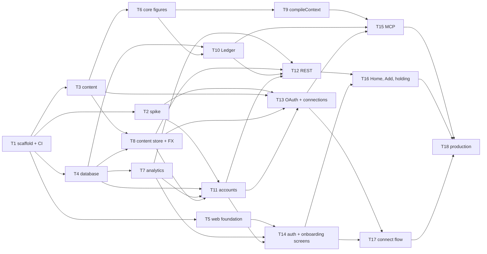
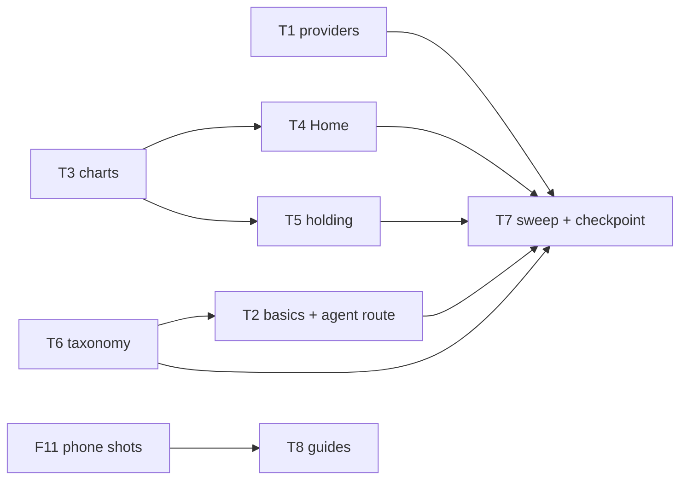
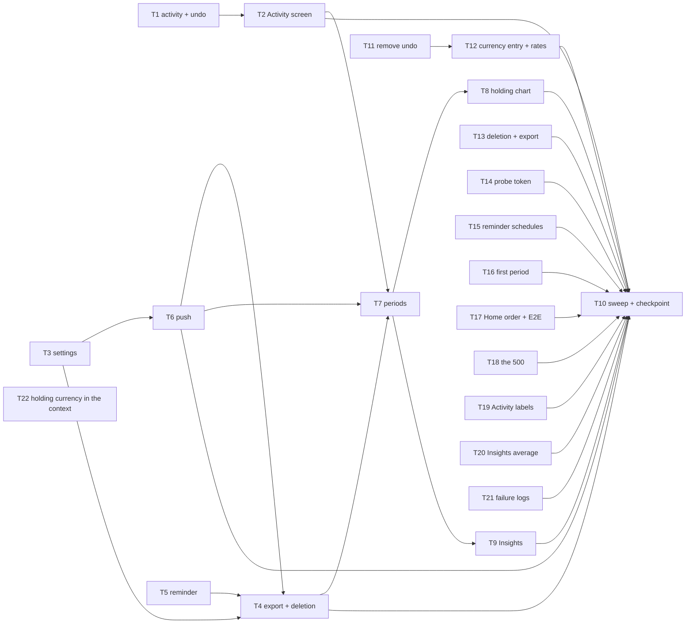
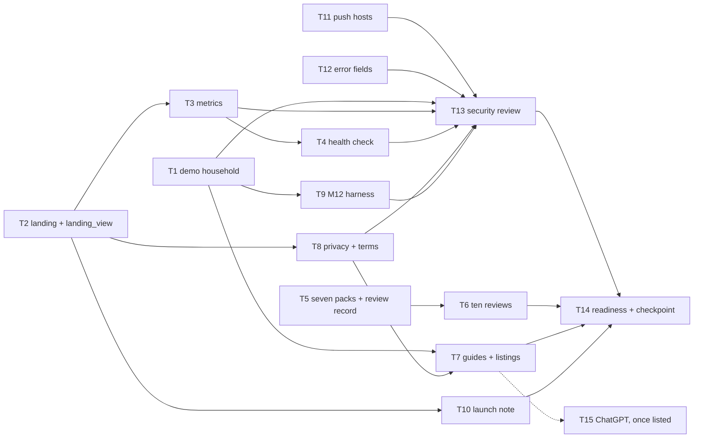

# 04 — Plan

Status: **approved** · Stage owner: Software engineering manager
Inputs: `docs/01-prd.md` (§6 acceptance criteria), `docs/03-architecture.md`, `CONVENTIONS.md`

> Phases are vertical slices, each ending in a checkpoint deployed to production that the Founder
> can use. Every phase has task briefs: `docs/phases/P1/tasks/`, `docs/phases/P2/tasks/`,
> `docs/phases/P3/tasks/` and `docs/phases/P4/tasks/`.

---

## 1. How v1 is delivered

Four phases. The riskiest assumption goes first: that a person can connect Claude or ChatGPT to
their own balance sheet, ask it something, and let it write (A1, A2, A4). Everything the experiment
depends on (the MCP layer, the §3.5 analytics, the distribution assets) comes before Insights, which
is built last within P3 (PRD §4.1).

**Rules that hold in every phase**

1. **Every phase ends on production**, on the Founder's domain, deployed by the manual workflow
   (architecture §9.2). Until launch, production is unannounced and `/` is a holding page.
2. **A capability lands in the Ledger, REST and MCP in the same phase.** Its screen may follow in a
   later phase. There is one implementation, so the agent is never behind the UI (J6).
3. **Every event a phase's flows fire is wired in that phase.** §3.5 is the experiment, not a
   finishing touch.
4. **Additive endpoints, fields, parameters or message kinds that the architecture implies** (for
   example, the approval page's API) are added to architecture §7 by the build and listed in the
   task report. Any other change to §7 is stop-and-raise (CONVENTIONS §12).
5. **Launch (Stage 8) needs all four phases approved.**

## 2. Phases at a glance

| Phase | Slice | Checkpoint (on production) | Jobs |
|---|---|---|---|
| **P1** | **Ask your agent about your real position** | Sign up by email, confirm the country, add holdings by hand and see what you could use; connect Claude (or any MCP agent through "Other agent") in one flow; the agent answers from `get_financial_context` and writes values that appear in the app, marked as its own. Instrumented, isolated, backed up, probed | J1–J3 (core), J5, J6, J8; J10 isolation |
| **P2** | **Worth using on its own** | Google and Apple sign-in; onboarding's start screen and the basics; the full Home (trend, allocation, baseline, filters, staleness, the agent handoff); the full holding page; types and tags | J1–J5 (rest), J9 |
| **P3** | **Trust, ownership, comeback and Insights** | Activity, a read-only log of every change; settings (currency, country); export and account deletion; the comeback reminder by web push or email; the security email's retries; monthly, quarterly and yearly change with drivers, filters and exclusions; `get_period_changes` | J2 (country change), J7, J10, J12, J11 |
| **P4** | **Ready to launch** | The landing page; the metrics per segment; usage and SLO alerts; all ten packs reviewed; guides and directory listings ready; the launch note; the M12 harness | G-D1–G-D4, M12, packs |

## 3. P1 — Ask your agent about your real position

### 3.1 Checkpoint

On `https://‹domain›`, deployed by the production workflow:

1. A visitor signs up with an email and a password and is asked nothing else. They carry on
   unverified while the verification email goes out.
2. Onboarding asks where they live (inferred from the IP on our server, confirmed with one tap, any
   country from an alphabetical list) and, optionally, their segment. They land on Home.
3. They add holdings with the Add form: an asset or a liability, any currency, accessibility settled
   by a fact question, a pack default with its reason, or "Not sure". Home shows net worth and what
   they could use, what is locked (and until when) and what they owe.
4. From the Agent tab they connect Claude (or any MCP agent through "Other agent"; ChatGPT joins once
   NetNet is listed in OpenAI's directory) in one
   flow: steps for their platform, NetNet's approval page, and NetNet moving on by itself. The
   security email arrives.
5. In the agent they ask "what am I worth?" or "can I afford a S$120K car?" and get an answer built
   on `get_financial_context`. They hand it a statement and it creates holdings and records values,
   which appear in the web app with a quiet agent mark and the client named on the value.
6. Revoking the connection rejects the agent's next call.
7. Every step fires its §3.5 event with `segment`. The RLS and isolation suites pass in CI. Daily
   encrypted backups run, and a probe exercises the MCP path every 6 hours.

### 3.2 Acceptance criteria in P1

Stage 6 tests P1 against these criteria (PRD §6). The rest of each job waits for the phase named.

| Job | In P1 | Waits |
|---|---|---|
| **J1** | Sign-up by email and password asks nothing else · verification email sent, the user carries on · returning user resumes onboarding or goes to Home · one holding with a value → a total equal to it · a first picture with no agent states something the user did not type (could use, locked and until when, owed) · signup events carry no amounts · unverified users use the app but cannot connect an agent · segment recorded by one skippable question and carried by every event | Google and Apple (P2) · the "Let's start" screen, the basics, Skip, Back and the P-A walk-through (P2) · the agent route from onboarding and the blank Home after it (P2) · the empty Home's full rule, with and without an agent (P2) |
| **J2** | Add an asset or liability (name, type, currency, value, date; tags wait) · liabilities subtract · accessibility recorded in one of four states · asked as a fact, never a category · no-doubt types set with the pack's reason, overridable · generic pack for unpacked markets · country inferred, confirmed, alphabetical, currency default · pack types added on confirmation · instruments from any country · consequence shown, changeable from the holding · never blocks saving, asking the agent offered · "Not sure" → undecided, marked, with a way to decide · foreign currency stores original, conversion, rate and rate date | Tags; add, rename, merge and delete types and tags; archive; delete from the web (P2) · changing country afterwards (P3) · a delete shown in the audit log (P3) |
| **J3** | Add a dated value, back-dated allowed, latest by date drives the total · same date: last write wins, with a warning · `value_recorded {source}`; `value_corrected` when an agent corrects a value | Editing a value on the web (P2) · the edit shown in the audit log (P3) |
| **J5** | Everything except the handoff prompts: steps per client and platform with screenshots and the connector URL, no token · "Other agent" · Back step by step · the Connect button's logos · the same flow from the Agent tab and the empty Home · verify first, with resend, moving on by itself · approval moves NetNet on by itself · connection shown active with client name and time · failures fire `agent_connection_failed` and show a plain cause and retry · revoke rejects later calls · the security email · M9 readable | Entries from onboarding and a holding (P2) · the prompt handoff for an empty or stale Home (P2) · the revocation shown in Activity (P3) |
| **J6** | All | — |
| **J8** | All, except the blind comparison (M12, P4) | — |
| **J10** | No screen or API response carries another user's data, verified by test | Export and deletion (P3) |

Non-functional requirements from P1: N1 measured (`latency_ms`) and probed, N2, N3 (audit rows on
every write; Activity shows them in P3), N4, N5, N7, N8, N9, N10, N11.

### 3.3 Tasks

Briefs: `docs/phases/P1/tasks/P1-T1.md` … `P1-T18.md`. Founder items are in §5.

| Task | Title | Depends on | Parallel-safe | Founder items first |
|---|---|---|---|---|
| P1-T1 | Scaffold the monorepo, CI and preview deploys | — | no | F4, F5 |
| P1-T2 | Spike: real Claude and ChatGPT over OAuth to a stateless MCP server | T1 | yes | F7, F8 |
| P1-T3 | Content: schemas, starting packs, countries and agent guides | T1 | yes | — |
| P1-T4 | Database: schemas, roles, row-level security and `withUser` | T1 | yes | F7 |
| P1-T5 | Web foundation: tokens, app shell and base components | T1 | yes | — |
| P1-T6 | Core figures: money, accessibility, position, staleness, series, duplicates | T3 | yes | — |
| P1-T7 | Analytics: `track()`, the event schemas and the client events endpoint | T4 | yes | — |
| P1-T8 | Content store and exchange rates | T3, T4 | yes | F9 |
| P1-T9 | Core: `compileContext`, the agent's context | T6 | yes | — |
| P1-T10 | Ledger module (P1 surface) | T4, T6 | yes | — |
| P1-T11 | Accounts: sign-up, verification, sessions, profile and `notify()` | T2 (verdict), T4, T7, T8 | yes | F2, F10 |
| P1-T12 | REST API (P1 surface) | T7, T8, T10, T11 | yes | — |
| P1-T13 | Agent OAuth server and connections | T2 (verdict), T3, T8, T11 | yes | — |
| P1-T14 | Web: sign-up, sign-in and onboarding screens | T5, T7, T11 | yes | — |
| P1-T15 | MCP server and tools | T9, T10, T13 | yes | — |
| P1-T16 | Web: Home, Add and the holding page | T12, T14 | yes | — |
| P1-T17 | Web: the Agent tab and the connect flow | T13, T14 | yes | F11 |
| P1-T18 | Production: deploy, observability, backups and probe | T15, T16, T17 | no | F12–F16 |

"Parallel-safe" means the task can run beside the others in its wave once its dependencies are
done; tasks in one wave touch different files.

### 3.4 Order

| Wave | Tasks |
|---|---|
| 1 | T1 |
| 2 | T2, T3, T4, T5 |
| 3 | T6, T7, T8 |
| 4 | T9, T10, T11 |
| 5 | T12, T13, T14 |
| 6 | T15, T16, T17 |
| 7 | T18 (its setup parts, such as Sentry, headers and the backup workflow, can start after T4) |

**The spike gates the auth work.** T2's verdict (`docs/phases/P1/spike.md` §5): the architecture
holds for Claude, on a computer and a phone, with no fallback library. The Founder's decisions on
its deviations are in `decisions.md`, and T11, T13, T15 and T18 build on them.

### 3.5 Running the build

- `stage: build P1` in a new session. The build session works wave by wave, dispatching one
  engineer subagent per task, and hands off to a new session between waves when its context runs
  heavy (STATE names the next wave). `stage: build P1-Tn` runs a single task.
- One branch and one pull request per task (CONVENTIONS §15). Every pull request gets its own
  preview, with its own Neon branch, from T1 and T4 onward. A preview's `DATABASE_URL` is injected
  per-deployment by its Preview job: never redeploy from the Vercel dashboard (the new deployment
  comes up without a database); re-run the Preview job instead.
- After T18, `stage: test P1` in a fresh session (WORKFLOW Stage 6), against §3.2.

## 4. P2 and later phases

P2, P3 and P4 are planned in detail below, with task briefs.

### P2 — Worth using on its own

Status: briefed. Briefs: `docs/phases/P2/tasks/P2-T1.md` … `P2-T8.md`.

#### Checkpoint

On `https://‹domain›`, deployed by the production workflow:

1. A visitor signs up or signs in with Google, Apple or email. Provider accounts are verified.
2. Onboarding's "Let's start…" screen offers the basics or the agent route. The basics walk the
   pack's checklist one question per screen, saving each answer at once, with Skip, Back and "Done
   for now". The agent route ends on a blank Home with the starting prompt.
3. Home shows the whole picture: net worth, trend and allocation (a carousel on a phone,
   side by side on a computer), the position ledger, change against the chosen baseline and
   trend range, sort, the filter sheet and Don't Show, and the stale count with the agent
   handoff. An empty Home offers one action and one alternative, with or without an agent.
4. A holding opens its own trend with a range bar and paged history with expandable rows;
   values edit and delete; holdings archive and delete from the top-right menu; tags assign.
   Its period bar chart lands in P3 with the period machinery.
5. Types and tags add, rename, merge and delete from the web; the Add form takes tags.
6. Stale holdings are labelled on list and detail. Every step fires its §3.5 event. The phone
   screenshots render in the connect guides.

#### Acceptance criteria in P2

Stage 6 tests P2 against these criteria (PRD §6), and re-checks the P1 criteria (§3.2) for
regressions.

| Job | In P2 |
|---|---|
| **J1** | Sign-up and sign-in by Google and Apple, verified, with the official buttons, `method` on the sign-up events · the "Let's start" screen and the basics (the pack's checklist, follow-ups only after a yes, each answer saved at once, Skip, Back with removal logged, "Done for now", `via: guided`, resume, the P-A walk-through) · the agent route from onboarding and the blank Home after it · the empty Home's full rule, with and without an agent |
| **J2** | Tags in the Add form · add, rename, merge and delete types and tags, holdings follow, nothing orphaned · archive and unarchive · delete from the web (audited in the rows; the log screen is P3) |
| **J3** | Edit a value on the web (amount, date, currency): history, totals and charts recompute, the edit is audited (shown in P3), `value_corrected` fires |
| **J4** | All except the holding bar chart: total, trend and allocation (carousel, side by side on a computer), the position ledger · the six baselines, every figure relative to the one in force and labelled, the baseline's name the control · trend ranges · a holding's trend with range bar, newest-first history with expandable rows, top-right menu (its period bar chart waits for P3) · the trend read by hover, tap, drag and arrow keys, a plain swipe still scrolling · the "Need more data" placeholder · sort (both value directions, type, money/percent change) and the filter sheet (Show Only, chips, AND/OR, Don't Show, archived, Apply) with the active filter visible · phone usable without sideways scrolling, computer side-by-side layout |
| **J5** | The same connect flow from onboarding and from a holding, `entry` carried · the prompt handoff for an empty or stale Home (the starting and update prompts, prefill where the client supports it, Copy where not, no financial data in prompts) |
| **J9** | All: staleness labels on list and detail · the stale count on Home, handed to a connected agent or offering to connect one · no scheduled stale-holding message of any kind |

Non-functional requirements in P2: N7 (the sweep), N9 (every new event prop an enum; the message
tests still pass), N10 (the deny-list scan covers the new code), N11 (every new figure from a pure
`core` function), N1 (the new tools carry `outcome` and `latency_ms` like the rest).

Carry-over from P1 (STATE, 2026-10-08): the 3 Claude phone screenshots ship as P2-T8; the F16
external monitor and inbox delivery of the verification and security emails are Founder and Stage 6
checks at the P2 checkpoint, not build tasks.

#### Tasks

| Task | Title | Depends on | Parallel-safe | Founder items first |
|---|---|---|---|---|
| P2-T1 | Google and Apple sign-in | — | yes | F17, F18 |
| P2-T2 | Onboarding basics and the agent route | T6 (mechanical: both extend `POST /api/holdings`) | yes | — |
| P2-T3 | Chart geometry and SVG components | — | yes | — |
| P2-T4 | Home complete | T3 | yes | — |
| P2-T5 | Holding page complete | T3 | yes | — |
| P2-T6 | Types and tags | — | yes | — |
| P2-T7 | Responsive sweep and the P2 checkpoint | T1, T2, T4, T5, T6 | no | — |
| P2-T8 | P1 follow-up: phone screenshots in the guides | — | yes | F11 (remainder) |

"Parallel-safe" means the task can run beside the others in its wave once its dependencies are
done; tasks in one wave touch different files. T2's feature needs nothing from T6; the dependency
is ordering only, so T6's `tagIds` and T2's `via` land on `POST /api/holdings` in separate waves.
T8 runs whenever the Founder supplies the files; it is content-only and never blocks T7.

#### Order

| Wave | Tasks |
|---|---|
| 1 | T1, T3, T6 |
| 2 | T2, T4, T5 |
| 3 | T7 |
| alongside | T8, once the Founder supplies the files |

#### Running the build

- `stage: build P2` in a new session. The build session works wave by wave, dispatching one
  engineer subagent per task, and hands off to a new session between waves when its context runs
  heavy (STATE names the next wave). `stage: build P2-Tn` runs a single task.
- One branch and one pull request per task (`p2-tn`, CONVENTIONS §15), each with its own preview
  and Neon branch. A preview's `DATABASE_URL` is injected per-deployment by its Preview job: never
  redeploy from the Vercel dashboard; re-run the Preview job instead.
- After T7, `stage: test P2` in a fresh session (WORKFLOW Stage 6), against the criteria above plus
  the P1 criteria. Suggested manual checks for Stage 6: inbox delivery of the verification and
  security emails; the F16 monitor watching `/api/health` and the OAuth metadata; a real Google
  and Apple sign-in on production.

**Founder items:** F17 Google, F18 Apple, F11 remainder (phone shots for T8).

### P3 — Trust, ownership, comeback and Insights

Status: briefed. Briefs: `docs/phases/P3/tasks/P3-T1.md` … `P3-T22.md`.

#### Checkpoint

On `https://‹domain›`, deployed by the production workflow:

1. Activity shows every change newest-first, grouped by agent turn, with what changed, old → new,
   client and time. It is a read-only log: a mistake is corrected by another change. Revocation
   reads there too.
2. Settings changes the default currency (every value re-derived from its stored rate, a
   person's own rates kept as given, one `system` entry in Activity) and the country (the new
   pack's types added, none removed), and signs out.
3. Export downloads everything as JSON or CSV; deletion states the 30-day window first, then
   erases `ledger`, identity, sessions, grants, endpoints and reminder state, revokes every
   connection, and stops every reminder at once.
4. Someone away for 30 days gets one gentle reminder, at most three per absence and only in
   their daytime — by push to every device they turned on, by email otherwise, with one-click
   unsubscribe and opened tracking. The security-email retries run inside the same runs, which
   are GitHub Actions schedules.
5. Insights shows Monthly, Quarterly and Yearly change with drivers, through its own persisted
   filters and exclusions; the holding page grows its period bar chart with the M/Q/Y switch
   and paging; the agent gets `get_period_changes`.
6. Every step fires its §3.5 event with `segment`.

#### Acceptance criteria in P3

Stage 6 tests P3 against these criteria (PRD §6), and re-checks the P1 (§3.2) and P2 criteria
for regressions.

| Job | In P3 |
|---|---|
| **J2** | Changing country afterwards (empty accounts start over; otherwise the new pack's types are added and none removed; labels follow the current pack, outcomes and reasons stay) · a delete shown in the audit log |
| **J3** | An edit shown in the audit log |
| **J4** | The holding page's second card: the bar chart of its period changes with the monthly / quarterly / yearly switch and paging, carried marking, the shared placeholder when history is short |
| **J5** | Revocation shown in Activity |
| **J7** | All: newest-first log with what changed, old → new, client and time, web changes in the same log · one agent turn read together · a record only, nothing in it changes data · `value_corrected` when an agent-written value is edited or deleted |
| **J10** | Export as JSON and CSV complete enough to rebuild a spreadsheet from · deletion (a recent sign-in, the 30-day window stated first, everything erased, connections revoked, reminders stopped, events re-keyed, `account_deleted`) · no screen or response carries another user's data, re-verified by test |
| **J11** | All, built last in the phase (PRD §4.1): three views with period rows newest-first, the first period with no change · drivers per period · own filters recomputing every figure · Don't Show exclusions persisting and leaving Home alone · placeholders with the single what's-needed statement · periods from value dates, carried marking, stored conversions · `insights_viewed {view}` |
| **J12** | All: due at 30/60/90 with no check, never a fourth, any check restarts the clock · daytime only · push where on, email otherwise, verified addresses only · the exact wording, no amounts or names · the Home card rules · Settings → Notifications · the device lifecycle · unsubscribe and opened tracking |

Non-functional requirements in P3: N1 (the new tool carries `outcome` and `latency_ms`), N3
(Activity completes the auditability P1 started), N7 (the sweep), N9 (every new event prop an
enum; every `notify()` message free of amounts, totals and names), N10 (the deny-list scan
covers the new code), N11 (periods from a pure `core` function).

#### Tasks

| Task | Title | Depends on | Parallel-safe | Founder items first |
|---|---|---|---|---|
| P3-T1 | Activity log and undo (Ledger, REST, MCP) | — | yes | — |
| P3-T2 | The Activity screen | T1 | yes | — |
| P3-T3 | Settings — currency, country, sign-out | — | yes | — |
| P3-T4 | Export and account deletion | T3, T5, T6 | yes | — |
| P3-T5 | The comeback reminder — timing, runs and email | — | yes | F19 (`LINK_SIGNING_SECRET`) |
| P3-T6 | Web push — channel, devices and asking | T3 | yes | F19 (VAPID keys) |
| P3-T7 | Periods — core, Ledger and the agent tool | T2, T4, T6 | yes | — |
| P3-T8 | The holding page's period bar chart | T7 | yes | — |
| P3-T9 | The Insights screen | T7 | yes | — |
| P3-T10 | Responsive sweep and the P3 checkpoint | T2, T4, T6, T8, T9; T11–T21 for production | no | — |
| P3-T11 | Remove undo; Activity is a read-only log | — | yes | — |
| P3-T12 | The default-currency change — one entry, a person's own rates kept | T11 | yes | — |
| P3-T13 | Account deletion leaves nothing behind; the export survives Safari | — | yes | — |
| P3-T14 | The probe's refresh token never reaches a log | — | yes | — |
| P3-T15 | The reminder runs on GitHub Actions schedules | — | yes | — |
| P3-T16 | Insights — the first period has no change | — | yes | — |
| P3-T17 | Home — the stale note under Position, and E2E with push | — | yes | — |
| P3-T18 | The intermittent 500 on `GET /api/me` — diagnosable, then fixed | — | yes | — |
| P3-T19 | Activity reads types by their labels, and dates as the screen does | — | yes | — |
| P3-T20 | Insights — the average's percent agrees with its amount | — | yes | — |
| P3-T21 | Failure logs name their cause, and a sign-out logs nothing | — | yes | — |
| P3-T22 | The context gives each holding's currency | — | yes | — |

T4's dependency on T3 is ordering only (both extend Settings); on T5 and T6 it is real (the
tables `destroy()` clears). T7's dependency is ordering only: Insights is built last in the
phase so a slip shows against the phase rather than eating the trust work (PRD §4.1). T8 and
T9 run in one wave from the same engine and share nothing new — common needs go through
`core`. The reminder backfill starts every existing user's clock on deploy day (P3-T5), so
nobody gets a surprise reminder.

T11–T18 come from triaging Stage 6's report (`docs/phases/P3/feedback.md`). T14 goes first,
because the token in the latest workflow logs is live; once it merges, the Founder rotates the
token (its brief lists the steps). T15 must reach production before the first reminders fall due,
around 2026-11-14. T12 follows T11 because both change the audit write path. When all eight are
merged, the production workflow deploys, P3-T10's open criterion is verified there (the
checkpoint, and the reminder schedule's first runs), and `stage: test P3` runs again.

T19–T21 come from triaging the re-test's report (the same `feedback.md`): three Low issues, each
a small task that touches nothing the others do. When all three are merged, the production
workflow deploys again, P3-T10's production criterion is verified on it, and `stage: test P3`
runs once more.

T22 comes from a Founder report after P3's approval: `get_financial_context` gives no currency
for a holding without a value. It touches nothing the others do. It merges and deploys on its
own, with no re-test of P3.

#### Order

| Wave | Tasks |
|---|---|
| 1 | T1, T3, T5 |
| 2 | T2, T6 |
| 3 | T4 |
| 4 | T7 |
| 5 | T8, T9 |
| 6 | T10 |
| 7 | T14 first, then T11, T13, T15, T16, T17, T18 |
| 8 | T12 |
| 9 | T10's production criterion (deploy, then verify) |
| 10 | T19, T20, T21, then T10's production criterion again |
| 11 | T22, after P3's approval |

#### Running the build

- `stage: build P3` in a new session. The build session works wave by wave, dispatching one
  engineer subagent per task, and hands off to a new session between waves when its context runs
  heavy (STATE names the next wave). `stage: build P3-Tn` runs a single task.
- One branch and one pull request per task (`p3-tn`, CONVENTIONS §15), each with its own preview
  and Neon branch. A preview's `DATABASE_URL` is injected per-deployment by its Preview job: never
  redeploy from the Vercel dashboard; re-run the Preview job instead.
- After T10, `stage: test P3` in a fresh session (WORKFLOW Stage 6), against the criteria above
  plus the P1 and P2 criteria. Suggested manual checks for Stage 6: a real iPhone (NetNet on the
  Home Screen) and an Android phone receiving and opening a push reminder; inbox delivery of a
  reminder email; one-click unsubscribe; a daytime-only send; revocation visible in Activity.

**Founder items:** F19 VAPID keys and the link-signing secret (before T5/T6); a real iPhone
(NetNet on the Home Screen) and an Android phone for Stage 6's manual push check (architecture
§12 risk 16).

### P4 — Ready to launch

Status: briefed. Briefs: `docs/phases/P4/tasks/P4-T1.md` … `P4-T15.md`.

#### Checkpoint

On `https://‹domain›`, deployed by the production workflow, still unannounced (`noindex` until
Stage 8):

1. `/` is the landing page: §2.5's statement first, both proofs, a recording of Claude answering
   from a fictional household, the trust facts, and sign-up one tap away; `/privacy` and `/terms`
   beside it. Each visit fires `landing_view` with a cookie-less `visitor`.
2. The Founder reads M1–M11 and M13 per segment (M13 per channel), the kill readings on P-B and
   P-C, and the M10 funnel, from one workflow run as `netnet_metrics`.
3. A daily health check reads Neon's usage, the N1 SLO, the email allowance, unsent security emails
   and the exchange rates, and emails the Founder when a §9.4 trigger fires or a figure cannot be
   read.
4. All ten launch packs are live, each reviewed by someone who knows the market and recorded
   against the document reviewed.
5. The connect guides match Claude's screens today. The listing materials for Claude's and
   OpenAI's directories, the MCP Registry and the public lists are ready to submit once the privacy
   policy and terms are approved.
6. The launch note is ready to post. The M12 harness has run, and its result is stated against the
   80% line.
7. The security review is done and its Critical, High and Medium findings are fixed; a backup has
   been restored; the deploy waits for `main`'s green CI.

#### Acceptance criteria in P4

Stage 6 tests P4 against these criteria (PRD §3–§6), and re-checks the P1, P2 and P3 criteria for
regressions.

| Item | In P4 |
|---|---|
| **G-D1** | The landing page states §2.5's line first, never "you don't know your net worth" · both proofs, P-A's and P-B/P-C's · an agent answering a real question from a real balance sheet (recording, no audio, fictional data) · its own design · the call to action straight to sign-up · every claim true of the product |
| **G-D2** | Listing materials complete for Claude's directory, OpenAI's directory, the MCP Registry and the public lists, each against its published requirements; submission waits for the legal pages (Stage 8) |
| **G-D3** | One launch note, led by §2.5's statement, the proof varied per audience, for 3+ communities that between them reach all three personas, P-B and P-C at least twice each |
| **G-D4** | `landing_view` with a cookie-less `visitor` on every load · the M10 funnel readable before launch |
| **§3.2, §3.3** | M1–M11 and M13 readable per segment (M13 per channel), from events alone, as `netnet_metrics` · the kill readings on P-B and P-C, never on the blend · signups are verified accounts (`email_verified`) |
| **J8 (M12)** | The blind comparison: NetNet against a spreadsheet upload of identical data, on a deliberately weak model, scored on numeric correctness, qualification and fabrication; the result stated against "≥ 80% of pairs, never worse on fabrication" |
| **§2.3** | Packs for all ten launch countries, each reviewed by someone who knows the market before it is live in production; every other country still gets the generic pack |
| **J5** | Claude's guide, phone and computer, matches today's screens, every step with its screenshot |
| **J6** | A tool's error names only the tool's own fields |
| **J12** | Push is sent only to the browsers' push services |

Non-functional requirements in P4: N2 (the M12 harness is outside the product), N4 (the isolation
and RLS suites cover the new routes and scripts), N5 (the new secrets live only in GitHub and
Vercel settings), N6 and N8 (the health triggers watch every free-tier limit), N7 (the landing
page at phone width), N9 (`landing_view` sets no cookie and stores nothing in the browser; the
health alert, the metrics and the M12 reports carry no personal data), N10 (the deny-list covers
the seven new markets), and the security review across all of them.

#### Tasks

| Task | Title | Depends on | Parallel-safe | Founder items first |
|---|---|---|---|---|
| P4-T1 | The demo household — a fictional balance sheet any account can load | — | yes | — |
| P4-T2 | The landing page, and `landing_view` | — | yes | F21 (the recording, on T1's household; a placeholder holds its place until it lands) |
| P4-T3 | The metrics, per segment | T2 (ordering) | yes | F24 |
| P4-T4 | The daily health check, and the Founder's alert | T3 | yes | F24, F25 |
| P4-T5 | The seven remaining launch packs, and the review record | — | yes | — |
| P4-T6 | All ten packs reviewed | T5 | yes | F20 |
| P4-T7 | Agent guides checked against today's screens, and the listings ready | T1, T8 (ordering) | yes | F11 |
| P4-T8 | The privacy policy and terms — drafts for legal review, and their pages | T2 (ordering) | yes | F23 (to finalise) |
| P4-T9 | The M12 harness — NetNet against a spreadsheet, on a weak model, scored blind | T1 | yes | F22 |
| P4-T10 | The launch note | T2 (ordering) | yes | — |
| P4-T11 | Push endpoints only at the browsers' own push services | — | yes | — |
| P4-T12 | An agent's error names the tool's own fields | — | yes | — |
| P4-T13 | The security review before launch | T1–T4, T8, T9, T11, T12 | no | — |
| P4-T14 | Launch readiness, and the P4 checkpoint | T1–T13, the review's fixes | no | the restore drill, the Actions budget |
| P4-T15 | ChatGPT, once OpenAI lists NetNet | OpenAI's listing, T7 | yes | F11 (ChatGPT's shots) |

T1 comes first because three tasks show the same fictional household: the landing page's
recording (F21, with a placeholder until it lands), the directory reviewers' test account (T7) and
M12 (T9). T3 follows T2 because both change the event contract and M10 reads `landing_view`; T4
follows T3 for the metrics role's login and the N1 query. T7, T8 and T10 follow T2 only so that the listings, the legal pages and the
launch note use the landing page as shipped. T11 and T12 are small fixes with nothing in common
with the rest: T11 is the push-endpoint limit named for the security review, fixed first because
the fix is clear, and T12 is the Low issue from P3's last test report, which a weak model (M12)
would trip on.

T13 runs in a fresh session once the code tasks are merged and deployed, reviews without changing
code, and its findings are triaged into new P4 tasks (P4-T16 onward). T6 runs as each reviewer
reports, one small change per pack; its last review is the long pole of the phase. T15 waits on
OpenAI's review, which NetNet does not control: it is outside the checkpoint and may land after
launch.

P3's report also left two Info notes; both follow the PRD and stay as they are: a type a pack does
not know reads by its universal label after a country move (J2, §6.7), and a carried month with no
change reads "—" in Insights and "$0" on the holding chart.

#### Order

| Wave | Tasks |
|---|---|
| 1 | T1, T2, T5, T11, T12 |
| 2 | T3, T7, T8, T9, T10 |
| 3 | T4 |
| 4 | T13 (a fresh session), then the fix tasks its triage writes |
| 5 | T14 |
| alongside | T6, as each review comes back; T15, when OpenAI lists NetNet |

#### Running the build

- `stage: build P4` in a new session. The build session works wave by wave, dispatching one
  engineer subagent per task, and hands off to a new session between waves when its context runs
  heavy (STATE names the next wave). `stage: build P4-Tn` runs a single task.
- One branch and one pull request per task (`p4-tn`, CONVENTIONS §15; T6 one per pack,
  `p4-t6-<pack>`), each with its own preview and Neon branch. A preview's `DATABASE_URL` is
  injected per-deployment by its Preview job: never redeploy from the Vercel dashboard; re-run the
  Preview job instead.
- T13 is not a build task: `stage: build P4-T13` starts a fresh review session, and its report goes
  to the Founder before any fix is written.
- After T14, `stage: test P4` in a fresh session (WORKFLOW Stage 6), against the criteria above
  plus the P1–P3 criteria. Suggested manual checks for Stage 6: the landing page on a real phone
  and its link preview in a messaging app; the recording under reduced motion; a test health alert
  in the inbox; the metrics workflow's summary; one pack read by its reviewer on production.

**Founder items:** F20 reviewers, F21 the recording, F22 the API key, F23 the legal review, F24 the
metrics role, F25 the alert address, F11 (fresh Claude screenshots for T7; ChatGPT's six for T15),
the MCP Registry's DNS record (at submission, T7), and T14's restore drill and Actions budget
check.

## 5. Founder setup checklist

Each item sits before the first task that needs it. **Secrets go straight into Vercel or GitHub
settings, never into chat or a file.** Generate a random secret with `openssl rand -base64 32`.
"Vercel env" means the project's Environment Variables, for Production and Preview unless noted.

**Start now (long lead times)**

| # | Item | Needed by |
|---|---|---|
| F1 | Enrol in the Apple Developer Program ($99/year; approval can take days) | P2 (Sign in with Apple) |
| F2 | Buy the domain | P1-T11 (email DNS), P1-T18 |
| F3 | Find a reviewer who knows each launch market: SG, MY, ID, PH, TH, VN, HK, IN, AU, GB | P4 |

**Before `stage: build P1` (T1, T2, T4)**

| # | Item | Needed by |
|---|---|---|
| F4 | **Vercel:** a Hobby account linked to GitHub, and a project for `terrence0488/netnet`. Turn **off** Vercel Authentication for Preview deployments (agents must reach a preview's `/mcp`; previews hold fictional data only). Create a token. GitHub → Settings → Secrets and variables → Actions: secrets `VERCEL_TOKEN` and `VERCEL_PROJECT_ID` (CI reads the project's owner from the project) | T1 |
| F5 | **Cloud environment network access:** in this environment's settings (the environment menu in the session's title bar → Edit → Network access), allow Vercel and Neon: `vercel.com`, `api.vercel.com`, `*.vercel.app`, `console.neon.tech`, `*.neon.tech` | T1, T2, T4 |
| F6 | After T1 merges: install the free **Renovate** GitHub app (github.com/apps/renovate) on this repository only, in the mode **Scan and Alert** ("Scan Only" silences Renovate), so library updates arrive as weekly pull requests. Merge any pull request only when its **Checks** job is green: `main` has no branch protection (decisions.md) | T2 onward |
| F7 | **Neon:** projects `netnet-prod` and `netnet-preview`, region AWS Singapore (`aws-ap-southeast-1`), **Postgres 18**, compute 0.25 CU. In each, a role `netnet_owner` (made in the console). GitHub secrets: `NEON_API_KEY`; `DATABASE_OWNER_URL` (prod, `netnet_owner`, direct connection); `NETNET_APP_DB_PASSWORD_PROD` and `NETNET_APP_DB_PASSWORD_PREVIEW`, two different values from `openssl rand -hex 32` (letters and digits only, because they go inside a connection string; keep the prod one in your password manager for F12). GitHub variables: `NEON_PROD_PROJECT_ID`, `NEON_PREVIEW_PROJECT_ID` | T2, T4 |
| F8 | A Claude plan that allows a custom connector (every plan; the free plan allows one) | T2 |

**During P1**

| # | Item | Needed by |
|---|---|---|
| F9 | Vercel env `CRON_SECRET` (generated) | T8 |
| F10 | **Resend:** an account; add the domain and set the DNS records it shows (SPF, DKIM, DMARC). Vercel env: `RESEND_API_KEY`, `EMAIL_FROM` (e.g. `NetNet <hello@‹domain›>`), `BETTER_AUTH_SECRET` (generated), and on Preview only `EMAIL_PREVIEW_ALLOW` (the addresses previews may email) | T11 |
| F11 | The 3 remaining Claude phone setup screenshots (the 3 computer shots shipped in P1; ChatGPT's 6 once it is listed), named as in `docs/02-prototype/connect/README.md`, cropped, with name, email, avatar and chat titles removed. Put them in `content/images/connect/` | P2-T8 |
| F12 | Point the domain at the Vercel project. Vercel env (Production): `PUBLIC_ORIGIN` (`https://‹domain›`) and `DATABASE_URL` (the pooled `netnet_app` connection string; T4's report gives its exact form) | T18 |
| F13 | **Sentry** (Developer plan, free): one project for the function, one for the web app. Vercel env: `SENTRY_DSN`, `VITE_SENTRY_DSN` | T18 |
| F14 | **Backup key**, on your own computer: install `age`, run `age-keygen -o netnet-backup.key`. The public key (`age1…`) → GitHub secret `BACKUP_PUBLIC_KEY`. Keep the key file offline, in two places. It is the only way to read a backup | T18 |
| F15 | **Probe:** once production is up, create the probe account (fictional data) and approve the probe's connection as T18 describes; create a fine-grained GitHub token for this repository only, with "Secrets: read and write", as GitHub secret `PROBE_SECRETS_TOKEN` (the probe stores its rotated refresh token with it) | T18 |
| F16 | A free external uptime monitor (e.g. UptimeRobot) on `https://‹domain›/api/health` and `https://‹domain›/.well-known/oauth-authorization-server`, alerting your email | P1 checkpoint (open; rechecked at P2's) |

**Later phases**

| # | Item | Needed by |
|---|---|---|
| F17 | Google OAuth client (Google Cloud console: consent screen, web client, the redirect URIs P2's brief lists). Vercel env: `GOOGLE_CLIENT_ID`, `GOOGLE_CLIENT_SECRET` | P2 |
| F18 | Sign in with Apple (needs F1): a Services ID, domain verification, a key. Vercel env: `APPLE_CLIENT_ID`, `APPLE_TEAM_ID`, `APPLE_KEY_ID`, `APPLE_PRIVATE_KEY` | P2 |
| F19 | VAPID keys, on your own computer: `npx web-push generate-vapid-keys`. Vercel env: `VAPID_PUBLIC_KEY`, `VAPID_PRIVATE_KEY`, `VAPID_SUBJECT` (`mailto:` your address), and `LINK_SIGNING_SECRET` (generated) | P3 |
| F20 | The reviewers from F3 engaged, one per pack, each sent P4-T6's review sheet for their market | P4-T6 |
| F21 | The landing page's screen recording: Claude answering a real question from P4-T1's fictional household, recorded to P4-T2's script. The page carries a placeholder until it lands | P4-T2 (placeholder), launch |
| F22 | An Anthropic API key, with a monthly spend limit set in the Claude Console, as GitHub secret `ANTHROPIC_API_KEY` (or in your own shell); approve each M12 run's spend | P4-T9 |
| F23 | Have P4-T8's drafts of the privacy policy and terms reviewed by someone qualified, then tell the build what changed; needed before directory listings are submitted (Stage 8's legal basics) | P4-T8 → Stage 8 |
| F24 | **Metrics role:** `openssl rand -hex 32` → GitHub secret `NETNET_METRICS_DB_PASSWORD_PROD`, before P4-T3 deploys. After that deploy: GitHub secrets `DATABASE_METRICS_URL` (the pooled connection string for `netnet_metrics`, in the form of `DATABASE_URL`) and `METRICS_EXCLUDE_USERS` (the probe account's user id and your own test accounts', comma-separated) | P4-T3, P4-T4 |
| F25 | Vercel env (Production) `OPS_EMAIL`: the address the daily health alert goes to | P4-T4 |

## 6. Coverage

| PRD item | Phases |
|---|---|
| J1 | P1, P2 |
| J2 | P1, P2, P3 |
| J3 | P1, P2 (edit), P3 (in the log) |
| J4 | P2, P3 (holding bar chart) |
| J5 | P1, P2 (other entries, handoff), P4 (guides re-checked) |
| J6 | P1, P4 (error fields) |
| J7 | P3 |
| J8 | P1 (M12 in P4) |
| J9 | P2 |
| J10 | P1 (isolation), P3 |
| J11 | P3 |
| J12 | P3, P4 (push services only) |
| G-D1–G-D4 | P4 |
| §2.3 packs | P1 (machinery; generic, SG, MY, GB), P4 (the other seven; all ten reviewed) |

| §3.5 events | First fired in |
|---|---|
| `signup_started`, `account_created`, `session_started`, `holding_created`, `value_recorded`, `value_corrected`, `agent_connection_started`, `agent_connection_completed`, `agent_connection_failed`, `agent_tool_called`, `security_email_sent` | P1 (all 20 schemas exist from P1) |
| `holding_created {via: guided}` | P2 |
| `reminder_sent`, `reminder_opened`, `push_prompt_shown`, `push_prompt_result`, `push_enabled`, `push_disabled`, `account_deleted` | P3 |
| `landing_view` | P4 |
| `insights_viewed` | P3 |
| `email_verified` | P4 (added to §3.5 so that M1's verified signups are countable) |

## 7. Delivery risks

| Risk | Mitigation |
|---|---|
| The spike finds that Better Auth's OAuth provider or CIMD falls short with a real client | The architecture's fallback (a standalone OAuth 2.1 library) is taken inside T2's scope; anything larger comes back to the Founder before T11 and T13 |
| P1 is the largest phase (18 tasks) | Seven waves with parallel tasks; the build session hands off between waves; the spike runs early so a surprise costs least |
| The Founder's hands-on steps (the spike, screenshots, secrets) hold up a wave | §5 places each item before the task that needs it; waves 3–4 continue while the spike waits |
| Previews are public so agents can reach them | Previews hold fictional seed data only and their own Neon project |
| Pack reviewers are the long pole for launch | F3 starts now; packs are content, so they can be written from P1-T3 onward, beside the build |
| Directory listings need legal pages that belong to Stage 8 | P4 prepares the materials; submission follows the legal basics |
| Provider setup (F17, F18; F1's Apple enrolment has a lead time) holds up P2-T1 | T1 is wave 1 but standalone: the email flow is unaffected and the other wave-1 tasks proceed; the providers land when the Founder's setup does |
| The phone shots arrive late | P2-T8 is content-only and off the critical path: the sweep and checkpoint (T7) never wait for it; P4-T7 completes it |
| The directories' reviews (Claude's, OpenAI's) take time NetNet does not control, and need the legal pages first | P4 prepares every listing; submission follows F23; launch never waits for ChatGPT (P4-T15 is outside the checkpoint) |
| M12 shows no lift | It is the experiment, not a build failure: the question set and rubric are fixed before the first paid run, the result goes to the Founder as evidence about A13, and nothing is tuned toward a pass |
| P4 leans on the Founder's hands (reviewers, the recording, screenshots, legal review, the restore drill) | Each is named at the task that needs it; waves 1–3 build while they are in progress |
